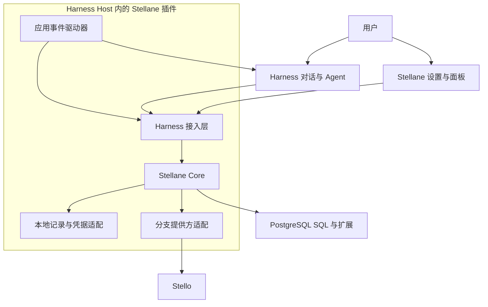

# Stellane 产品规划

更新于 2026-11-12。项目处于设计阶段，尚未实现功能或运行基准。

## 1 产品与目标

Stellane 为智能应用和子代理管理 PostgreSQL 数据环境，让任务继承已有工作、独立尝试方案、交付结果，并按需要保留数据和使用计算。

第一版以 **DeepSeek Harness 本地插件**交付：在 Harness 中配置资源、发起任务，通过内嵌面板观察和管理运行过程。Core 作为独立 TypeScript 库，由 Host 插件加载；数据库可位于本地或远端。

主要用户是开发智能应用的工程师和 Agent 平台团队。要验证的价值是：应用、任务和探索路径增加后，环境准备、继承、重置和回收是否更容易，资源开销是否合理，结果能否检查和继续使用。

## 2 使用流程与界面

1. 安装插件，在设置页登记项目、数据库连接、业务基线、分支提供方、凭据引用和资源限制。
2. 在对话中提出目标，或在面板中启动应用，由业务事件触发 Agent 任务。
3. 父任务查询数据、检索知识，持久保存中间结果和约束，选定用于派生的数据状态。
4. 子代理按需要申请环境，继承父任务已完成的工作，独立修改并交付方案。
5. 用户在面板中比较结果，选择继续、保留或回收；业务应用在采用前核对当前数据和权限。

例如：“这次供应延期影响哪些订单？分别试替代采购和跨仓调货，比较成本与交期，保留可行方案。”

| 界面 | 首版内容 |
| --- | --- |
| 设置页 | 项目、连接、业务基线、分支能力、凭据引用、预算和保留策略 |
| 任务与环境面板 | 按应用查看任务树与环境来源，显示 Agent、环境和数据库计算各自的状态；支持应用启停、环境派生、保留、计算释放与回收 |
| 面板详情 | 执行记录、结果摘要与证据、方案比较、任务笔记，以及知识候选的版本审核 |
| 对话与工具卡片 | 发起和继续任务，解释方案；操作卡片显示实际数据库目标、来源状态、执行结果与引用 |

面板与 Agent 工具调用同一套 Core，使用相同的授权和状态记录。操作后展示实际结果；数据库暂不可达时显示最近观测时间与待核实状态。只开放当前数据库支持的操作。

## 3 首版业务演示

使用供应链与订单业务，每个应用实例拥有独立的业务数据、合同和历史记录。

| 步骤 | 行为 | 验证点 |
| --- | --- | --- |
| 事件进入 | 接收供应延期、库存不足或订单即将逾期的事件，Agent 判断影响并创建任务 | 保存应用、事件、目标和预算；任务拆解随输入变化 |
| 父任务调查 | 查询订单、库存和供应商，检索合同与历史处理记录，保存修改、约束和中间结果 | 记录实际来源，形成可继承的数据状态 |
| 并行尝试 | 子代理分别尝试采购、调货或分批交付，需要时继续派生 | 继承父任务已完成的工作；修改不进入父环境或兄弟环境 |
| 等待与继续 | 保留部分方案，按数据库能力释放计算，之后重新访问 | 数据与结果仍可找到；环境、计算和 Agent 状态分别记录 |
| 比较与采用 | 按预先定义的成本、交付和库存规则比较方案，由业务应用执行选定操作 | 有结果证据，采用前检查当前状态和重复请求 |
| 结束与扩量 | 回收放弃的路径，增加应用数、事件频率、派生宽度与深度 | 额度有效、回收可追踪，规模以实测报告 |

应用事件驱动器运行在 Harness Host 插件中，由面板启停。关闭面板不停止应用；停止应用后停止接收新事件，已运行任务按结束策略处理。Host 退出后不再触发任务，重启时核对保留记录、未完成操作与待回收资源。数据库提供方自身的到期策略另行记录。

真实 Agent 用于验证动态工具调用与子代理行为，固定请求回放用于重复测量容量，两类结果分别报告。

## 4 数据环境与状态

数据环境是任务访问和修改数据的工作范围，关联数据库目标、来源状态、任务上下文、结果、权限和资源策略。

| 对象 | 关键记录 |
| --- | --- |
| 项目与连接 | 稳定项目 ID、连接身份、用途、数据库能力、凭据引用和权限 |
| 应用 Application | 所属项目、业务基线、事件入口、知识范围和运行限制 |
| 任务 Task | 应用、目标、来源事件、父任务、当前环境，以及 Harness Agent / Session 与检查点引用 |
| 环境 Environment | 来源环境与数据库版本、继承内容、数据库绑定、生命周期、权限和预算 |
| 执行与结果 Run / Result | 实际目标、SQL 或能力版本、输入、状态、耗时、结果位置、来源版本和交付对象 |
| 计算与知识 | 可复用 SQL / UDF 的不可变版本；知识内容、证据、适用范围和审核状态 |

任务与环境分别生成自有 ID，Harness Session 和数据库分支身份作为外部关联。任务树和环境来源分别记录：只读子任务可以共用环境，需要独立修改或保留不同方案时再派生。

### 继承与交付

- 派生前提交需要继承的修改，固定数据库来源状态，保存持久结果、约束和必要任务摘要。父环境之后的改动通过明确操作更新来源。
- 子环境的私有修改与笔记留在自己的路径中；向父任务显式交付摘要、证据和有权限访问的结果引用。
- 继承数据库中的持久数据后，重新建立子环境的对象与结果绑定；数据库之外的文件和外部服务状态由应用管理。
- 数据库版本与 Agent 检查点关联保存，数据环境的继续使用和 Agent 执行恢复分别验收。SQL 会话、临时表与未提交事务不作为可恢复进展。

### 数据存放

| 位置 | 内容 |
| --- | --- |
| Stellane 本地持久记录 | 项目、应用、任务、环境来源、运行时绑定、执行记录、结果引用、知识版本与审核 |
| 目标 PostgreSQL / 分支 | 业务数据、文档与 embedding、任务修改、持久中间结果和明细 |
| Harness | 原始对话、Agent 执行记录和运行时恢复；凭据通过宿主或用户指定来源适配，Core 只保存引用 |
| 数据库提供方 | 远端分支、物理存储和计算状态，Stellane 查询并发起授权操作 |

结果引用绑定明确版本，重算产生新结果；删除环境后保留来源摘要并标记明细不可用。知识分为候选、已确认、已替代和已归档，用户在面板审核具体版本并留下审核记录；任务笔记与已确认知识分开，默认检索当前已确认内容。

## 5 架构与职责

| 部分 | 职责 |
| --- | --- |
| Harness | 对话、模型调用、Agent 与子代理执行、Session 记录和运行时恢复 |
| Harness 接入层 | 原生工具与 Skill、Agent / Session 绑定、界面请求和事件更新 |
| Stellane Core | 环境来源与绑定、授权、并发与预算、SQL 与计算执行、结果交付、知识和生命周期 |
| 应用事件驱动器 | 在 Host 运行期间接收事件、触发 Agent，管理应用启停和业务采用 |
| 分支提供方适配 | 查询能力、固定来源、创建与派生、取得连接，以及实际支持的计算释放、恢复和删除 |
| 客户端插件 | 设置页、任务与环境面板、详情和工具卡片，通过 Host 访问 Core |

Core 的类型和规则独立于 Harness 与数据库提供方。接入层从可信调用上下文取得主体和 Agent 身份，将任务绑定到环境，再由 Core 检查授权；面板操作同样校验用户与目标。并行任务使用各自绑定，环境 ID 只用于定位。

配置、面板和工具展示分别接入 Harness 的[设置扩展](https://github.com/deepseek-ai/deepseek-harness/blob/master/packages/client/ui-settings/README.md)、[面板扩展](https://github.com/deepseek-ai/deepseek-harness/blob/master/packages/client/ui-sidebar/README.md)和[工具视图](https://github.com/deepseek-ai/deepseek-harness/blob/master/packages/client/ui-tool/README.md)。首个阶段固定验证版本，核实插件生命周期、子代理绑定、检查点引用和状态更新接口；宿主类型留在接入层。

## 6 首版范围与运行规则

首版交付可安装的 Harness 插件，包含 Host 接入、Core、客户端界面、Skill、示范应用、复现配置与测量报告。辅助命令行用于诊断与负载回放。

| 能力 | 首版范围 |
| --- | --- |
| 数据访问 | 授权范围内执行查询、DDL 和 DML，注册可复用 SQL / UDF，保存持久结果与执行记录 |
| 检索 | 数据库结构与业务说明，已验证的全文 / pgvector 检索，记录 embedding 模型、来源和索引版本 |
| 环境管理 | 创建、绑定、固定来源、派生、查看、交付、保留与回收；先用 Stello 验证分支能力 |
| 资源管理 | 按项目与应用限制环境数、派生深度、并发数据操作和活跃计算；任务预算从应用或父任务中分配 |
| 本地知识 | 跨 Session 检索、候选与证据保存、版本审核和失效管理 |
| 界面与演示 | 设置页、任务与环境面板、工具卡片，多应用事件驱动演示与容量回放 |

普通 PostgreSQL 支持直连查询、计算和保存结果，pgvector 安装验证后提供向量检索。固定来源、分支隔离、计算释放与恢复按提供方实际能力报告；直连目标标为实时数据库。

首版限本地运行与单个 Host 的管理范围。独立托管服务、跨机器协调、团队共享、其他宿主接入、自动分支合并和任意跨库搬运不在首版范围内。

### 必须保持的运行规则

- 权限同时受主体授权、项目策略、环境范围与数据库角色限制，SQL 权限和分支管理权限分别检查；子任务权限取获准子集，预算从父任务或应用额度中分配。Core 统一登记操作、占用额度并持久化状态。
- 创建环境分别记录请求登记、分支创建、SQL 就绪和首条 SQL 完成。派生绑定明确来源版本，无法固定来源时返回能力不足。
- 取消、释放计算和删除前核实运行中操作、后代依赖与实际资源身份；同名重建分配新身份，旧连接与结果不得指向新资源。
- 超时、断连或重启后先查询实际状态，再决定继续或重试；未知结果的写操作不得盲目重放。Host 运行期间及显式调用时处理回收，退出后保留待处理记录。
- 环境、Agent、SQL 连接和数据库计算分别计数、分别显示状态。数据库状态的隔离与数据库之外的业务副作用分别管理，采用方案由业务应用校验执行。

## 7 开发顺序与验收

| 阶段 | 交付与验收 |
| --- | --- |
| 接入验证 | 插件能安装、配置并显示面板；真实父任务与子代理调用工具、绑定各自环境，操作状态能更新到面板 |
| 继承与隔离 | 父任务修改与持久结果可被继承，兄弟环境修改隔离，交付结果可追溯 |
| 完整应用 | 事件进入、调查检索、动态子任务、方案比较、采用前检查与知识审核形成完整演示 |
| 生命周期 | 验证等待与计算释放、继续访问、取消、预算限制、回收及重启后的状态核实，处理失效引用和未知操作 |
| 扩量与交付 | 多应用、规模回放、基础对照与可支持的基准测量；提供安装说明、复现配置和完整报告 |

## 8 测量与依据

以普通 PG + pgvector + Agent 工具与脚本为基础对照，按需要加入同一分支数据库直接接工具的对照，分别衡量底层数据库和 Stellane 管理能力的贡献。

数据库操作测试测创建、连接、读写、派生、计算释放和删除；少量真实 Agent 验证动态行为；调用回放测容量。对照尽量统一任务、数据、模型、扩展、资源预算与验收规则，差异明确记录。

| 指标 | 记录内容 |
| --- | --- |
| 正确性 | 父状态继承、兄弟隔离、权限、业务约束、结果来源和失效状态 |
| 准备延迟 | 请求登记、分支创建、SQL 就绪、首条 SQL 完成，报告分位数 |
| 规模与进度 | 应用、任务、Agent、保留环境、连接和活跃计算数量，吞吐、排队、等待与失败 |
| 资源开销 | 增量存储、历史保留、峰值、活跃计算时长，删除与物理回收；端到端计入模型、embedding、索引和数据准备成本 |
| 检索与继续 | 检索相关性、来源、近似检索损失与延迟；重新访问耗时、数据完整性、未知操作和孤立资源 |

报告固定数据库、扩展、宿主与基准版本，记录数据规模、参数、硬件或服务规格、冷暖缓存、错误及未支持能力。保留环境数量与活跃计算数量分开报告。

参考资料：

- [Supporting Our AI Overlords: Redesigning Data Systems to be Agent-First，CIDR 2026](https://www.cidrdb.org/cidr2026/papers/p32-liu.pdf)：参考 Agent 探索、状态派生和重复工作带来的数据系统需求。
- [BranchBench: Aligning Database Branching with Agentic Demands，arXiv:2604.17180 v1](https://arxiv.org/abs/2604.17180v1)：参考分支、修改、评估与比较的工作负载。
- [BranchBench2 参考提交 275c459](https://github.com/branch-bench/BranchBench2/tree/275c459bfe27d88c048dff1240f922731c7cacdd)：2026-11-12 核对的代码版本。接入时逐项报告操作支持范围；merge、rebase 等可选能力按实际情况测量，缩减用例与模拟操作单独标明。
