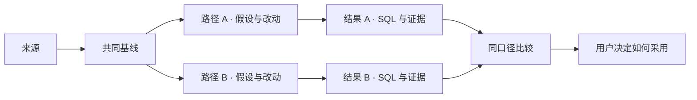

# Stellane 产品设计

## 为什么需要它

用户用 Agent 分析数据库时，反复遇到三个问题：第一次不知道数据怎么用，第二次忘了上次查明什么，面对几个可行改法时又无法从同一份数据出发分别验证。

Stellane 是 DSH 的数据插件。用户在普通对话中提问和提出试验，Agent 调用已授权的数据库；Stellane 提供上下文、验证发现、保存证据，并管理从共同基线展开的独立试验路径。面板帮助用户看清发生了什么。

多条路径对应产品最重要的决策场景：先理解现状，再让不同假设各自运行，用同口径结果比较，最后决定下一步。记忆让后续调查利用已验证的发现，证据让结果可追溯，数据库分支让不同改动互相隔离。

面向通用业务。表名、业务实体、指标含义和修复规则来自用户的数据及要求，产品代码不预设某一行业的模型。订单、设备事件、工单等都可以用来验收相同能力。

## 三个问题，三组能力

| 用户要解决的问题 | 产品能力 | 用户能看到的结果 |
| --- | --- | --- |
| 如何正确理解和查询数据？ | 表与字段目录、业务定义、声明关系、视图血缘、只读查询 | 答案用的对象、口径、SQL 和执行记录 |
| 如何复用已查明的关系，避免用错旧结论？ | 行键和等值关联的验证、记忆、使用前复核、失效记录 | 已保存的关系、观测范围、原验证和最新复核的差别 |
| 几个改法各会怎样，应该选哪条路径？ | 从同一基线创建独立试验，分别保存结果，用相同口径比较 | 各路径的假设、改动、指标差异、证据与资源保留状态 |

Agent 负责理解意图、选择查询、提出假设和解释结果。Stellane Core 负责访问检查、验证 SQL、证据持久化、记忆适用性与实验生命周期。数据库执行 SQL；Neon、Stello 等提供分支。每层承担可检验的职责。

## PostgreSQL 承载分析，分支承载试验

查询、目录、血缘、记忆和指标证据都建立在 PostgreSQL 的 SQL 与目录能力上。Neon 用连接 URL 接入时同样可用。只有需要隔离写入的实验才调用提供方的管理 API。

| 能力 | PostgreSQL / Neon URL | Neon 分支控制器 | Stello |
| --- | --- | --- | --- |
| 只读 SQL 与执行证据 | 支持 | 支持 | 支持 |
| 表结构、业务定义、视图血缘 | 支持 | 支持 | 支持 |
| 隐性键与关联的验证和记忆 | 支持 | 支持 | 支持 |
| 指标口径、总量与覆盖检查 | 支持 | 支持 | 支持 |
| 独立写入试验 | 需分支提供方 | 支持 | 支持 |
| 基线与结果的保证 | 查询发生时的观测 | Stellane 保护为只读的分支 | 提供方固定的数据切面 |
| 实验结束 | 保留执行记录 | 关闭访问，保留结果及必要父分支 | 清理临时工作分支，保留固定结果 |

界面和 Agent 工具根据实际能力提供动作。没有分支能力时，仍能完成分析、血缘和记忆；说明缺少的能力及接入方式即可。

Neon 的只读分支不等于物理不可变的数据切面。外部管理员可以变更数据或重置分支，Stellane 记录身份、检查重置，并要求复核历史观察。Neon 结果的父链保留要在任务里明确显示：本地 Docker 占用磁盘，云资源另有费用。预览版的真实分支路径使用开源 Neon 与 Stellane 本地开发控制器，不要求购买云服务。数据库管理保证的差异不能被统一按钮掩盖。

## 为什么要保留多条试验路径

分支对应的是决策前的验证空间。用户可以同时有几个还未确定的假设，每个假设需要自己的数据状态；来源库继续作为来源，试验里能真正执行 DDL / DML，并留下可重复查看的结果。

共同基线让差异有明确起点。若 A 和 B 各自在不同时间读取实时库，新到的数据就可能与方案改动混在一起。先保存一份基线，再分别派生，可以记录两条路径相同的来源身份。Stello 对基线提供固定状态保证；Neon 基线按只读管理，外部变更仍须检查和说明。

每条路径的改动只在它自己的工作分支上发生。一个方案的写入或回滚不会改写其他分支的数据。结果交付保存自己的查询证据，原对话与面板可以读取这些已执行结果。证据说明实际发生了什么，不能单凭「查询成功」或「覆盖完整」判断业务规则正确。

| 适用场景 | 路径示例 | 比较时必须保留的依据 |
| --- | --- | --- |
| 数据修复存在不同假设 | A 更正原记录的关联键；B 补充候选映射 | 各分组如何变化、缺失是否减少、总量是否保持、业务依据是否充分 |
| 分配或分类规则要调整 | A 按当前规则修正，B 使用另一个明确给定的规则 | 同一批输入、相同指标定义、受影响记录和各路径结果 |
| 数据结构或转换逻辑要修改 | A 保持当前结构，B 新建表、字段或视图并运行验证 | 查询是否仍成立、结果差异、改动 SQL 和执行证据 |

这些场景只有在需要修改数据或结构、并比较结果时才启动写入试验。普通数据库问答、资料检索和血缘调查继续使用只读流程。数据库提供方承担分支存储与执行，Stellane 管理试验身份、范围、来源和证据；低成本分支的收益与启动开销以具体提供方的测量为准。

当前多路径操作由同一普通对话先保存共同基线，再创建不同名称的实验。各实验可以分别完成、保存与结束，Agent 在对话里读取结果并比较，面板展示各自任务。系统尚未提供通用多 Agent 并行调度、统一多方案比较页或生产自动合并。单个指标修复任务已有基线与结果的同口径比较。

共享基线由发起者显式保留，结束其中一个实验不会把其他实验的共同起点当作私有临时资源删除。Stello 可清理各任务的临时工作分支；Neon 保留结果时还可能需要保留父链存储。用户应能看到哪些资源结束访问、哪些仍保留及其原因。

## 用户的主要路径

### 1. 接一次库

在「数据源」选择 PostgreSQL 或 Neon，粘贴连接 URL，确认名称与项目目录，点击连接。Host 验证连接，安全保存凭据，自动建立可用的只读环境。字段方式和凭据引用留在高级设置。

不要求预先写业务词典、上传资料或理解分支术语。只要能读取表结构，就可以在项目里提问。业务说明可在需要确定口径时补充。失败时保留已填内容，给出可操作的错误信息。

启用本地 Neon 实验时选 Neon (Docker)，导入开发环境输出的配置文件；实验性云入口才需要云项目、分支与 API 凭据。Stello 使用导出的客户端配置。实验能力是可选接入步骤。

### 2. 在普通对话中问

内置 `stellane-data` Skill 引导 Agent 发现当前项目可用的数据源、读目录、查记忆和执行 SQL。只匹配一个来源时直接使用；多个来源有歧义时才请用户明确范围。用户无需先从 Stellane 面板打开对话。

Agent 在探索中提出有依据的关系，Core 生成检查 SQL，核对非空、唯一性和匹配覆盖。通过后自动保存，后续同环境的授权对话可找到它。数据本身的吻合只能证明观测范围内的关系，不能凭空决定业务含义。

### 3. 想知道依据时点开证据

对话中的指标结果提供证据入口，定位原执行记录。面板显示实际口径、数据范围、总量、无法归因记录和各段关联检查；SQL 和标识放在详情中。失败或截断以文字状态显示。

实时数据中的旧关系使用前复核，失败时显示原验证与本次检查各自的记录和原因。单纯再次看到相同表结构，不代表表里的数据没有变。复核在使用时发生，当前没有持续监听所有外部写入。指标检查在当前环境发现关系反例时，也会直接标记旧关系失效，保留本次指标范围，和整表检查的证据区分。

### 4. 提出假设，展开独立路径

用户在对话里说明假设或修复规则。单次验证可以直接创建实验；比较多个方案时，先保存一份共同基线，再为 A、B 等方案创建不同名称的实验。各实验在自己的工作分支执行改动、核验并保存结果。实验拥有者的会话有权访问工作分支，同项目其他对话不会因此自动获得权限。

用户说「分别试算这两种映射，按相同口径比较」时，Agent 应在结果里说明共同起点、两种改动、可比的指标和残留疑问。来源、单位或统计范围不一致时先说明差异，不能只按数字高低排方案。

从指标异常的「试算修复」进入时，沿用原指标的计算计划，分别计算基线和结果。比较的是同一口径下的覆盖、分组和总量。普通实验则由 Agent 提供可复核的只读证据 SQL。

交付后结束实验，按提供方能力清理或保留资源。结果不明的写入先查原回执，派生先查原资源，不能以重试名义盲目重复操作。生产采纳由用户的业务系统决定。可操作的示例见[分支试验教程](docs/experiments.zh-CN.md)。

## 面板分工

| 页面 | 主要问题 | 默认内容 |
| --- | --- | --- |
| 任务与结果 | 刚才做了什么，进行到哪，结果是什么？ | 查询、实验状态、证据、返回原对话与收尾动作 |
| 数据目录 | 有哪些数据，已知道什么，为什么这样认为？ | 表和字段、业务说明、声明关系、视图血缘、已验证与失效的观察 |
| 探索 | 我要自己查 SQL 或锁定一个范围 | 当前环境、手动 SQL、执行历史、绑定环境的提问入口 |
| 数据源 | 能访问哪些库，能做哪些操作？ | 连接、项目归属、连接测试与可用能力 |
| 管理与清理 | 哪些内容还在用，怎样停止或删除？ | 访问与凭据、保留资源和依赖、记忆归档、本地资料删除 |

日常入口保持为聊天，面板承担监控、查证和管理。数据源代表已登记的连接；环境代表当前读写目标；实验代表一次隔离验证；证据代表已经发生的一次执行。一个词对应一个对象。

切换面板的环境不改变已有对话的绑定。来源失效或权限变化时提示重新选择。操作的状态、SQL 和结果在聊天与面板之间引用同一份记录。

## 记忆与证据的边界

- **定义**来自数据库注释、用户资料或明确的业务来源，带版本、对象依赖和出处。SQL 示例供 Agent 参考，不会因为导入而自动执行。
- **结构关系与视图血缘**来自数据库目录。视图引用了哪些上游列，不等于已解析每个输出字段的计算表达式。
- **探索记忆**来自实际验证，目前覆盖行键和等值关联。保存对象、验证时间、查询记录及适用环境；可变环境里的观察使用前复核。
- **查询证据**说明某次执行做了什么。实时结果记录观测时刻；不可变切面另有提供方保证。历史结果不会因为重新查询而被改写。
- **指标证据**针对受支持的结构化计算，在同一 SQL 语句快照内核对覆盖和总量，避免多次读取混合不同时间的数据。

当前指标工具支持 1–4 段连续等值关联、分组计数、可选数值求和与一个等值筛选。无法归因的记录仍计入总量并单独显示。目标键多义、数值缺失或证据不全时标为待核实。去重、比例、任意表达式等由普通只读 SQL 完成，并明确各自口径。

记忆不能仅凭同名表或共同祖先跨分支复用。当前同环境复用与指标修复任务限定的关系计划继承已有实现，通用跨分支记忆传播仍需补齐独立的授权与适用性证明。

## 停止使用与删除

停用来源阻止新查询和分支，但保留所有者查证、核对与收尾。凭据替换先验证再生效。归档停止复用并释放容量，原证据可读；移除连接只移除登记和不再使用的插件自建凭据。用户明确要求删除资料时，另提供输入来源名确认的本地资料与历史删除，不把“归档”冒充删除。

分支清理以记录的实际身份为准，来源永不可删除；先处理子分支，保留共享基线的依赖原因。活动或未知操作未解决前不得删除记录以掩盖结果。结束实验不等于清掉所有保留结果。备份、DSH 聊天、提供方存储和模型方日志各有生命周期，本地删除不承诺物理擦除。

## 已有实现与后续工作

当前实现覆盖普通聊天接入、一次连接、目录与业务定义、视图依赖、行键和关联记忆、关系失效原因、执行与指标证据，以及独立实验与共享基线下的多个命名试验。所有者管理已覆盖访问停用、凭据替换、归档、保留资源回收和本地资料删除；状态包含版本迁移、备份与单写者占用。Stello 采用固定切面；Neon 采用管理 API 与只读分支。比较可在对话中依据各任务证据完成，状态保存在单个 Host 中。

已有真实 PostgreSQL 与独立 Stello 数据库测试，也已用 DSH 和实际模型完成合成业务的关系发现、跨对话复用、实时关系失效与修复试算。一次冷/热对话对照只能说明该样例的行为，不能推导出生产场景的固定收益。Neon API 契约测试与真实云端验收分别记录，不用前者替代后者。

下一阶段按可观察到的问题推进：

1. 用更多可替换业务数据验证正确性、复核成本与重复探索减少，持续检查真实本地 Neon 与 Stello 的分支和恢复。云适配按实际用户需求单独推进。
2. 增加按需读取更大目录、保留策略与批量管理；现有归档和明确本地删除已可用。
3. 完善授权子任务、跨分支记忆适用性和多个方案的统一比较。
4. 根据真实需求扩展列级转换与外部任务血缘，以及单 Host 之外的恢复与部署。

第二宿主、向量或混合检索、多模态接入只有在明确需求下再增加，不作为使用现有能力的前置条件。

## 演示与验收原则

验收应回答四件事：答案是否正确，证据能否复查，旧知识会不会误用，试验是否隔离且资源有交代。

仓库提供[设备事件与服务工单演示](examples/README.zh-CN.md)，包含初始化数据、受控变更、候选路径与预期输出。它们分别用于展示通用能力，演示表名和规则不进入产品逻辑。使用者可以先运行已知答案的样例，再换成自己的表。

使用可替换的合成数据和独立预期答案。问题拆解和 SQL 由 Agent 完成，不预置业务专属的 Agent 执行脚本。至少覆盖两个业务形态，避免把某一组演示表名固化到产品。

PostgreSQL 必须单独完成发现、保存、新对话复用、修改数据后的复核失效与重启保留。分支提供方另外验收来源未被写入、私有分支访问、共同基线身份、A/B 之间的隔离、相同口径下的结果差异、未知操作恢复及清理/保留状态。UI 要能从普通对话查到同一份证据，无需依赖隐藏工具详情。
