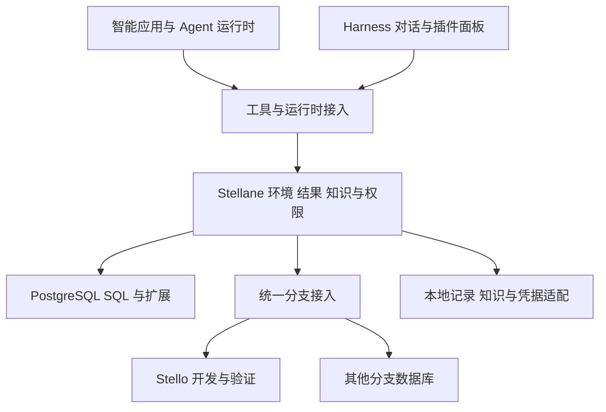

# Stellane 产品规划

更新于 2026-11-12。

Stellane 为智能应用和子代理提供可继承、可分叉、可独立修改、可保留和按需计算的 PostgreSQL 数据环境。

项目目前处于产品设计阶段。本文定义产品方向与第一版演示，文中的能力和规模需要通过实现与测量验证。

## 1 要验证的产品方向

我们的长期假设是：越来越多应用会根据用户目标和业务事件生成任务，派生子代理，检索知识、处理数据，并尝试不同方案。

应用数量、每个应用的任务数量，以及每个任务派生的探索路径，会共同增加需要管理的数据环境。一个任务可能等待很久，其中一部分工作会失败或被放弃，也有些结果值得保留并继续使用。

Stellane 要让应用和 Agent 容易完成这些事：

- 从业务状态或父任务进展开始工作，继承已有数据、约束和中间结果。
- 在独立环境里实际修改数据，沿不同路径并行探索。
- 保留任务的数据状态，同时按需要使用和释放数据库计算资源。
- 交付有来源、有检查依据的结果，再通过业务操作采用成果。
- 管理大量环境的归属、权限、预算和结束方式。

主要用户是开发智能应用的工程师，以及提供 Agent 应用运行设施的平台团队。首版围绕应用持续生成任务、派生环境、交付结果和回收资源的过程组织。

### 怎样衡量价值

以普通 PG + pgvector + Agent 工具与脚本为基础对照，比较任务完成成本和结果可靠性。

Stellane 与支持分支、按需计算的数据库一起，要验证的是：随着应用、任务和探索路径增加，准备、继承、重置和回收环境是否更容易，资源开销是否更合理，结果是否仍可检查和继续使用。

向量检索提供文档与知识的语义访问，低成本分支支持独立状态的派生，按需计算让等待中的环境保留数据。分别测量它们对准备时间、任务吞吐、资源开销和结果质量的影响。

## 2 核心对象是任务使用的数据环境

数据环境（Environment）是任务访问和处理数据的工作范围。它关联数据库目标及其状态、任务上下文、结果、权限和资源预算，不等同于一个连接、一段聊天或一个常驻 Compute。支持分支时可以固定来源版本；直接连接普通数据库时记录为实时目标，不承诺固定快照或独立修改状态。

| 层次 | 保存什么 | 寿命与用途 |
| --- | --- | --- |
| 应用 Application | 应用身份、业务入口、基线连接、知识范围和运行限制 | 持续接收业务事件，产生多次任务 |
| 任务 Task | 目标、来源事件、父任务、运行时引用、当前环境和检查点关联 | 由应用或 Agent 运行时创建，可等待、结束或继续派生 |
| 数据环境 Environment | 来源状态、数据库绑定、继承范围、私有结果、权限和资源策略 | 可由任务使用、保留和派生，计算可按能力释放 |
| 执行与结果 Run / Result | 实际目标、SQL 或能力版本、执行状态、指标和结果位置 | 用于复用计算、检查结果和追溯过程 |

任务树与数据环境的来源关系分别记录。多个只读子任务可以共用环境；需要独立修改或保留不同方案时再派生。一个任务可以先后使用不同环境，不要求每个 Agent 都单独开一个数据库。

### 继承、共享和交付

| 信息 | 怎样使用 |
| --- | --- |
| 业务基线和应用知识 | 按应用与任务权限读取，记录实际数据版本及知识来源 |
| 父任务的工作状态 | 在明确检查点选定继承范围，包括已提交的数据修改、持久中间结果、约束和必要的任务摘要 |
| 子任务的私有状态 | 保存该路径的修改、结果和笔记，不自动传播到父任务或兄弟任务 |
| 返回父任务的成果 | 显式交付方案、摘要、证据和可读取的结果，接收方检查权限与来源 |
| 应用长期知识 | 与任务笔记分开管理，提升为已确认知识需要审核 |

从父环境派生时，子环境应能看到选定状态中已经完成的工作。父环境随后发生的修改不会默默进入既有子环境；需要更新来源时，作为明确操作记录。无法固定所需状态的数据库接入，报告能力不足。

数据库版本与 Agent 检查点需要关联，但它们不是同一种状态。数据库分支不自动保存模型进程、原始聊天、外部文件或第三方服务。接入的运行时负责 Agent 执行恢复，Stellane 负责核对所关联的数据环境和结果。

环境数、Agent 数、SQL 连接数和活跃数据库计算数分别记录。停止计算不会自动删除环境，保留环境也不要求长期占用 SQL 连接。

## 3 第一版演示：持续运行的智能应用群

使用供应链与订单作为示范业务。每个应用实例拥有自己的业务数据、合同和历史记录，接收供应延期、库存不足、订单即将逾期等事件。

演示目标是运行一组会持续产生任务、派生环境并交还资源的应用。业务评分采用预先说明的成本、交付和库存规则，Agent 决定如何调查与尝试方案。

### 3.1 应用生成任务

事件进入应用，由 Agent 判断影响范围并提出任务，例如“这次供应延期影响哪些订单，怎样满足交期和成本要求”。保存来源事件、应用身份、目标和预算。

第一条接入链路要验证真正的 Agent 工具调用与子代理创建。任务拆解随输入变化；固定脚本用于可重复的负载回放时，另行标明。

### 3.2 父任务形成工作状态

父任务查订单、库存、供应商和相关关系，通过向量或全文检索找到合同与历史处理记录，形成受影响订单、候选资源、业务约束和中间结果。

把需要继承的工作持久保存，并把这次数据状态与运行时的检查点关联。演示检索实际使用的记录和来源，不把向量相似度当成业务规则已经得到证实。

### 3.3 派生子代理和独立环境

Agent 根据当前问题选择可行路径，例如替代采购、跨仓调货或分批交付。子代理从父任务选定状态继承数据，在各自环境内运行 SQL、调用计算并修改方案；必要时继续派生下一层。

演示中验证：子环境继承父任务已完成的修改和中间数据；子环境的修改不进入父环境或兄弟环境；权限和预算没有因派生而扩大。

### 3.4 等待、继续和收尾

让部分任务等待新信息，按数据库能力释放计算，随后重新访问保留的数据和结果。取消部分路径，按明确配置保留证据并回收不再使用的环境。

分别展示环境的生命周期、数据库计算状态和 Agent 执行状态。首版验证数据环境的继续使用；跨进程自动续跑 Agent 任务，要以运行时接入的实际能力单独验收。

### 3.5 比较和采用结果

按业务规则比较各方案，返回满足条件的方案、失败案例和证据。原始明细留在有权限访问的环境中，父任务获得显式交付的结果。

采用方案时，由应用执行明确的业务操作，重新核对当前订单、库存和权限，并记录执行结果。实验环境不长期占住业务资源，不默认将整个分支合并回业务库。

### 3.6 扩大应用与任务规模

逐步增加应用实例、事件频率、任务数、派生宽度与深度，以及保留环境数量。配置活跃计算与并发操作上限，观察排队、等待、继续和回收。

少量真实 Agent 用于证明动态行为；请求回放用于重复测量容量，两类结果分别报告。展示规模以实测为准，区分保留环境数量与活跃计算数量。

## 4 第一版范围与使用入口

| 范围 | 第一版要做到 |
| --- | --- |
| 应用与连接 | 在本地登记多个应用实例及其项目、连接、基线、知识范围和资源限制 |
| 任务与环境 | 记录任务归属、父子关系、来源状态、运行时引用，创建、绑定、查看、保留和回收环境 |
| 继承与隔离 | 在支持的数据库上固定来源，派生子环境，验证父子可见性及兄弟修改隔离 |
| SQL 与计算 | 授权范围内执行查询、DDL 和 DML，注册可复用 SQL 或 UDF，记录实际执行与结果 |
| 检索 | 查数据库结构与业务说明；在已验证的 pgvector / 全文能力上检索示范业务知识 |
| 中间数据 | 在授权位置保存持久结果，按来源和权限复用，连接断开后仍能找到记录 |
| 资源生命周期 | 限制本地接入的并发数据操作，按提供方能力释放和恢复计算，记录资源状态 |
| 本地知识 | 跨 Session 检索，保存候选、证据、版本及用户审核；任务笔记与已确认知识分开 |
| Harness 接入 | 原生工具、Skill、插件面板与结果卡片，查看应用、任务、环境和知识 |
| 对照测量 | 普通 PG + pgvector 基线、分支操作测量、应用级演示与容量回放 |

首版在本地运行多个示范应用实例，通过 Harness 使用和观察。正式多租户托管、团队共享知识及其他运行时接入不属于首版交付。

### Harness 中怎样操作

第一版使用 DeepSeek Harness。用户在其中配置数据资源、启动和观察示范应用、查看结果和审核知识。辅助命令行用于开发、诊断和可重复测量。

| 页面 | 用户看到和管理什么 |
| --- | --- |
| 应用 | 项目、应用实例、事件、业务基线、连接、检索能力及运行限制 |
| 任务与环境 | 任务与环境来源关系、Agent 归属、执行与结果、等待状态、计算状态和回收情况 |
| 知识 | 业务说明、候选与已确认知识、证据、修订和适用范围 |

对话解释任务与结果，工具卡片显示实际目标、来源和状态。复用 Harness 的[设置扩展](https://github.com/deepseek-ai/deepseek-harness/blob/master/packages/client/ui-settings/README.md)、[面板扩展](https://github.com/deepseek-ai/deepseek-harness/blob/master/packages/client/ui-sidebar/README.md)和[工具卡片](https://github.com/deepseek-ai/deepseek-harness/blob/master/packages/client/ui-tool/README.md)，插件实现具体内容。接入层隔离 Harness 尚未稳定的 API，首个开发阶段核实子代理与检查点的可用接口。

## 5 领域模型与代码分工

围绕 Application、Task、Environment、Run 和 Result 组织运行过程。Workspace、Connection、Branch、Capability 与 Memory 提供项目、数据库资源、计算和知识支撑。

| 对象 | 关键记录 |
| --- | --- |
| Workspace | 稳定项目 ID、名称、可选代码目录、设置和权限 |
| Application | 应用 ID、所属项目、基线连接、知识范围、运行策略 |
| Task | 任务 ID、应用、父任务、目标、事件、当前环境、运行时任务与检查点引用 |
| Environment | 环境 ID、目标模式（分支或直连）、来源环境与数据状态、继承内容、权限和资源策略、生命周期 |
| Connection | 连接 ID、地址、库名、认证引用；通过项目绑定说明开发、测试或生产等用途 |
| Branch | 自有 ID、提供方、不可复用的远端资源身份、来源版本、生命周期与最近观测 |
| Run | 执行 ID、任务与环境、实际数据库目标、SQL 或能力版本、状态、耗时与结果引用 |
| Result / Handoff | 结果 ID、来源执行、存放位置、结构、有效期、可用状态；交付时记录接收任务和访问方式 |
| Capability | 计算 ID、不可变版本、输入输出、SQL / UDF 实现、权限和会修改什么 |
| 环境上下文 | 数据库对象与关系、注释和统计、实际目标、来源与读取时间 |
| 本地知识 Memory | 内容版本、证据、适用范围、状态与用户审核 |
| Host Binding / Audit Event | 外部工作空间与任务引用；调用主体、目标、授权、操作和结果 |

这些是逻辑对象，不要求每项对应一张表。项目与连接保持多对多关系。任务、环境和执行 ID 由 Stellane 生成，Harness Session ID 或提供方分支名只作外部关联。

一个环境可以直接绑定普通数据库，也可以绑定受管理的分支。界面和工具明确说明当前采用哪种方式；直接绑定不会获得独立数据副本或修改隔离。

### 职责边界

| 部分 | 负责什么 |
| --- | --- |
| 示范应用与 Agent 运行时 | 接收事件，决定任务、拆解和子代理，调用 LLM 与工具，保存执行检查点，处理业务采用过程 |
| Stellane Core | 环境来源与绑定、数据操作授权、并发与预算检查、执行记录、结果交付、本地知识和生命周期管理 |
| Host Adapter | Harness 工具、Skill、页面与运行时关联；后续 MCP 等接入 |
| Branch Provider Adapter | 创建和查询分支、取得连接、解释状态，以及服务实际支持的固定来源、派生、计算释放和删除 |
| PostgreSQL 与扩展 | SQL、事务、数据持久化、全文或向量索引及具体计算 |

Core 使用独立 TypeScript 接口，Harness 与数据库提供方的类型留在适配层。首版在本地进程部署，应用和 Harness 访问同一套核心能力。Skill 提供使用指引，环境、权限和知识规则由 Core 执行，任务编排由应用与 Agent 运行时承担。

### 数据与状态放在哪里

| 信息 | 默认位置与责任 |
| --- | --- |
| 项目、应用、任务、环境与来源记录 | Stellane 本地持久化，优先通过适配复用 Harness 设施 |
| 凭据 | Harness 或用户指定的秘密来源，核心记录只保存引用 |
| 业务数据、文档、embedding、持久中间结果和任务工作数据 | 目标 PG 或分支内授权位置；只有纳入该数据库版本的状态才随分支继承 |
| 当前结构事实 | PostgreSQL 系统目录；统计与缓存记录读取时间和目标版本 |
| 结果位置、必要证据摘要、本地知识、修订和审核 | 独立于分支的本地记录，删除分支后保留来源并标记原明细不可用 |
| 原始对话与 Agent 执行检查点 | Agent 运行时管理，Stellane 记录必要引用和继承摘要 |
| 远端分支、物理存储与计算状态 | 数据库服务管理，Stellane 查询、关联和发起授权操作 |

向量生成由模型服务承担，embedding 模型、配置与数据来源要可追溯。索引、扩展、分支和计算恢复的兼容性按实际版本验证。派生环境后重新建立对象与结果绑定，物理继承的数据不自动使父环境的结果引用在子环境有效。

任务笔记可以自动保存。作为已确认知识使用的内容，仍按 Candidate、Verified、Superseded、Archived 管理。Agent 可以提出候选和查询审核状态，用户在插件界面审核具体版本；工具批准不等于知识确认。候选、已替代和已归档内容不默认作为当前事实。首版本地跨 Session 复用，团队共享知识另行实现。

## 6 环境生命周期、权限与失败处理

每次数据操作关联应用、任务、环境和实际目标。权限由主体授权、项目策略、环境范围和数据库角色共同限制，子任务只能在获准范围内继承。SQL 权限与分支管理权限分别检查，已有授权范围内无需逐条确认。

资源限制分别覆盖环境数量、派生深度、并发数据操作、活跃计算以及任务预算。子任务从父任务或应用额度中分配预算，派生不会重新获得一份完整总额度。Stellane 管理接入侧请求与策略，数据库服务实际分配资源，Agent 运行时负责 LLM 和子代理的并发。首版在演示配置中显式给出额度、保留和回收策略，产品默认值之后根据测量确定。

| 情况 | 必须保持的行为 |
| --- | --- |
| 创建环境 | 区分请求已登记、分支已创建、SQL 已就绪，测量到第一条实际 SQL 完成 |
| 固定来源并派生 | 记录父环境、数据库状态和检查点引用；无法确认来源时不静默改用最新状态 |
| 修改与交付 | 刷新相关上下文；临时 SQL 与注册计算并存；交付结果重新检查接收方访问范围 |
| 等待与恢复访问 | 持久数据保留；SQL 会话、临时表和未提交事务不作为可恢复进展 |
| 取消或结束任务 | 核实运行中的操作，再按任务策略保留、释放计算或删除环境 |
| 删除与回收 | 只处理身份明确且由本项目管理的资源；保留执行证据，标记失效结果，核对后代依赖与实际回收 |
| 重建同名资源 | 分配新的自有身份，核对远端生命周期，不接受旧连接和结果指向新资源 |
| 超时、断连或进程退出 | 查询实际执行状态，不推断写入失败，不盲目重放未知结果的写操作 |

中间结果留在获准使用的 Schema 或等效位置，返回引用和必要摘要。结果引用指向明确版本；重算产生新结果，不默默替换原数据。跨环境交付先检查来源、权限和可用性，首版只交付摘要与显式允许的结果访问，不做自动跨库搬运或任意数据合并。

分支隔离的是数据库状态，不保证 CPU、存储吞吐和外部服务完全独立。数据库之外的副作用由应用管理。首版示范业务把计划尝试写入环境数据；采用计划时通过业务操作核验当前状态，记录重复请求处理，避免把尝试直接等同于业务已执行。

数据库能力逐项报告。创建、固定来源、嵌套派生、暂停、释放计算、恢复、差异比较、合并和删除互不替代。Stello 是首个开发验证实例；其他提供方按自己的语义接入。普通 PG 的直接连接和脚本基线保留，不把隔离名称或 Schema 当作真实分支的证明。

## 7 研究依据与测试路线

这部分记录长期参考与测试入口，接入和测量结果在实际运行后补充。当前尚未复现论文实验、接入 BranchBench 或测得产品容量。

### 7.1 Agent-First 数据系统

[Supporting Our AI Overlords: Redesigning Data Systems to be Agent-First](https://www.cidrdb.org/cidr2026/papers/p32-liu.pdf)，CIDR 2026，UC Berkeley。

论文把智能体不断发现、尝试和检查的过程称为 agentic speculation，讨论规模、信息需求差异、重复工作和反馈引导。本产品据此关注任务状态派生、来源追踪、重复准备与计算开销，并通过应用级演示验证这些需求。

### 7.2 BranchBench

[BranchBench: Aligning Database Branching with Agentic Demands，arXiv:2604.17180 v1](https://arxiv.org/abs/2604.17180v1)，2026-04-19，Elaine Ang 等。

论文定义开发、故障复现、数据整理、MCTS 和模拟五类工作负载，采用分支、修改、评估与比较的循环，并测量分支操作。论文的范围是从一个根状态出发的单任务探索，不直接等于多应用并发或向量检索评测；这两部分需要本项目补充。

基准代码使用 [branch-bench/BranchBench2](https://github.com/branch-bench/BranchBench2)。2026-11-12 核对的参考版本为 [275c459bfe27d88c048dff1240f922731c7cacdd](https://github.com/branch-bench/BranchBench2/tree/275c459bfe27d88c048dff1240f922731c7cacdd)。该版本的 [README](https://github.com/branch-bench/BranchBench2/blob/275c459bfe27d88c048dff1240f922731c7cacdd/README.md) 定义六类场景；引用时区分代码版本与论文工作负载：

| 当前代码场景 | 本项目重点参考 |
| --- | --- |
| S1 Agentic RL environment | 从记录的步骤派生多条尝试 |
| S2 Agent context management | 长期上下文与候选分支 |
| S3 Multi-agent collaboration | 多代理修改与显式协作 |
| S4 Development agent | 业务状态变化时的开发分支 |
| S5 Operations agent | 故障调查和历史状态恢复 |
| S6 Data agent | 批量加工与结果交付 |

后续接入时固定提交、配置和数据规模，先检查可支持的操作。基准包含 merge、rebase 等可选语义，不能反推所有数据库或本产品首版必须具备；不支持的工作负载报告不支持，模拟实现与原生操作分别标注。修改或缩减后的用例明确标为本项目扩展，不称为原论文复现。

### 7.3 分三层测量

| 层次 | 怎样测 | 回答什么问题 |
| --- | --- | --- |
| 数据库操作 | 固定配置测创建、连接、读写、派生、删除和支持的计算释放；使用 BranchBench 可支持的操作与负载 | 分支数量、宽度、深度和修改量增加后，数据库行为与资源成本怎样变化 |
| 真实应用 | 少量真实 Agent 根据事件创建任务、调用工具和子代理，执行业务校验，保留完整记录 | 动态行为、继承、隔离、交付和继续工作是否成立 |
| 规模回放 | 根据真实调用协议与任务形状回放，增加应用数、到达频率、环境数量和活跃操作 | 接入侧与数据库的容量、排队、资源限制和回收是否可用 |

普通 PG + pgvector + Agent 工具与脚本作为基础对照，允许合理的复制和测试方法。对照尽量使用相同任务、数据、扩展、模型、验收规则和资源预算，记录无法对齐的条件；模型调用、embedding、索引构建和数据准备成本计入端到端结果。

按需要加入“同一分支数据库直接接工具”的对照，分开观察底层数据库与 Stellane 环境管理的贡献。

| 指标 | 记录方式 |
| --- | --- |
| 正确性 | 父状态继承、兄弟隔离、应用权限、业务约束、结果来源和失效状态 |
| 环境准备 | 请求到登记、分支创建、SQL 就绪、首条 SQL 完成分别计时，报告分位数 |
| 规模与并发 | 应用、任务、Agent、保留环境、SQL 连接和活跃计算分别计数 |
| 任务进度 | 完成吞吐、等待与执行时间、成功失败及取消数量，观察不同应用受到的影响 |
| 存储与计算 | 实际增量、历史保留、峰值与活跃计算时长；删除和物理回收分别观测 |
| 检索与结果 | 业务标注相关性、引用来源、近似检索损失和查询延迟分别检查 |
| 继续与回收 | 重新访问的耗时和数据完整性、未知操作核实、孤立资源与回收结果 |

所有报告记录数据库、扩展、接入与基准版本，数据大小、参数、冷暖缓存、硬件或服务规格、错误和未支持能力。保留了多少环境、同时运行多少计算、每秒完成多少任务分别报告。性能和费用由实测给出，不把分支登记速度当作 SQL 可用速度，也不把数据分叉当作确定性的模型重放。

## 8 开发顺序与验收

先跑通真实的任务环境链路，再增加应用与负载规模。主模型和来源语义先稳定，工具参数与界面细节随接入验证。

| 阶段 | 交付 | 验收 |
| --- | --- | --- |
| 核实接入与模型 | 应用、任务、环境和来源关联，Harness 工具与运行时接入，普通 PG 和分支能力报告 | 能追踪一个真实任务与子代理，核对运行时检查点和数据状态的关联边界 |
| 跑通继承与隔离 | 创建父环境、保存工作状态、派生子环境、SQL 与持久结果 | 父任务改动可被继承，兄弟修改隔离；同名重建与失效引用处理正确 |
| 完成应用演示 | 业务事件、检索、动态子任务、方案比较、采用前检查及本地知识 | 单个应用完成第 3 节完整过程，不依赖手动维护中间数据库状态 |
| 完成资源生命周期 | 等待、计算释放、继续访问、取消、额度和回收 | 分开验证数据保留与 Agent 执行状态；未知操作可核实，资源结束方式可追踪 |
| 增加多应用与测试 | 多应用实例、规模回放、普通 PG 基线、可支持的 BranchBench 测量 | 报告实际规模、正确性、延迟和资源消耗，能定位排队、失败和不支持的能力 |
| 整理首版 | Harness 三个页面、工具卡片、复现配置、记录与知识审核 | 用户从配置应用到观察任务、核对结果和回收环境能完成全过程 |

首版完成的依据是动态任务、继承、并行隔离、继续工作、结果采用和规模测量都形成可检查的记录。
