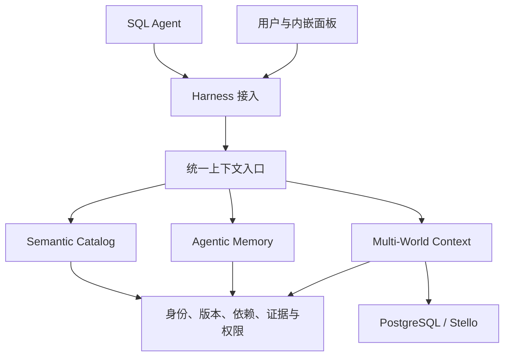

# Stellane · Agent Data Context

## 产品目标

为 SQL Agent 提供统一的数据上下文，使其更准确地理解业务数据、复用探索经验，并安全地尝试不同的数据状态。面向通用业务分析与 SQL 探索。

Agent 负责理解问题、选择假设、编写 SQL、解释结果和决策。Stellane 提供有来源的语义信息、可复用的探索知识、隔离的数据状态，以及权限与有效性检查。

Core 保持独立，首个接入为 DeepSeek Harness 本地插件，运行在 Host 内，使用其对话与 Agent 执行能力。内嵌面板展示配置、上下文、分支、证据和有效性状态。

## 核心能力

### Semantic Catalog · 语义目录

在数据库元数据之上，管理表与字段的业务含义、单位、数据关系、指标口径、常用计算规则和 SQL 示例。

每项语义记录来源、版本、关联的数据对象和适用条件。数据库注释、用户文档和 Agent 提议保留各自来源；未经证据支持的推断不能直接作为业务定义。口径或结构变化时创建新版本，并重新检查依赖它的知识与结果。

语义目录提供定义和使用依据；具体问题怎样查询与计算，由 Agent 决定。

### Agentic Memory · 探索记忆

保存值得复用的数据特征、查询经验、验证结果和计算结果。记忆须包含发现、适用条件、来源数据状态、依赖对象和验证证据；纯猜测与临时笔记保留为候选。

支持共享检索、更新、替代、归档和失效。共享以授权的数据范围为边界，检索返回内容、证据和适用性。大结果保存可验证的结果引用，预览截断不代表完整结果已被缓存。

记忆采用全自动流程。Agent 在探索中提炼发现并关联证据，系统自动验证、确定共享范围并发布；后续根据新证据和数据变化更新、替代或使其失效。

只有证据覆盖所声明的结论，且权限、依赖和数据适用性检查通过时，内容才进入可复用检索。SQL 成功执行不能单独证明任意业务结论。证据不足、相互矛盾或无法判断适用性时，系统标为待验证或失效，并按需要重新验证。

### Multi-World Context · 多分支上下文

复用 Stello 等提供方的数据库分支能力，从明确的数据状态创建独立探索路径。只读探索可共享数据状态，需要独立修改时再派生分支。

分支记录不可替换的资源身份、父状态和实际固定位置。已提交的持久数据与中间结果可以继承；未提交事务、临时表和外部副作用不属于数据库分支继承范围。

语义与记忆通过版本引用共享，各分支的新假设、私有笔记和结果单独记录。子分支只继承能证明仍适用的知识；共同祖先或相同表名不足以证明适用。子分支中的发现经验证和发布后，其他分支还须按各自状态判断能否复用。

### 统一上下文管理

统一检索入口接收当前主体、任务、数据状态与问题，组合适用的语义、记忆和结果引用，并说明来源和有效性。

| 对象 | 必要信息 |
| --- | --- |
| 数据状态 | 数据源身份、实时或固定状态、分支身份与来源位置、可用的结构及数据版本证据 |
| 上下文记录 | 类型、内容、版本、作者或导入来源、共享范围、适用条件与依赖 |
| 验证证据 | SQL 与参数、执行记录、实际数据状态、结果引用、完整性和验证时间 |
| 使用判定 | 对当前目标适用、待验证或失效的原因，以及需要补充的验证 |

发布状态（候选、已发布、已替代、已归档）与有效性（适用、待验证、失效）独立。记忆在一个分支上有效，并不意味着它在所有分支上都有效。

有效性按依赖判断：业务定义通常依赖语义与结构版本；数据特征依赖对应数据范围；计算结果还依赖 SQL、参数和输入状态；性能经验可能依赖索引、统计信息和运行环境。

首版采用保守判断：有依据证明依赖保持不变时才复用，依赖变化则重新验证。无法观测外部写入、依赖不完整或版本不足时标为待验证。实时库的执行时间和固定切面的版本分别记录。

## 使用流程

1. 用户连接数据源，补充业务语义并定义可访问的上下文范围。
2. Agent 获取当前数据状态下的语义、历史发现与可复用结果，自行展开 SQL 探索。
3. Agent 按需要固定状态、创建分支并验证不同假设。Stellane 记录来源、SQL 和结果证据。
4. Agent 提交可复用发现，系统自动验证、发布并维护适用范围。
5. 后续 Agent 使用这些记录时，系统检查权限与数据适用性；相关数据变化后重新验证或使其失效。

面板提供上下文检索、来源与依赖、数据分支、执行证据、记忆版本与有效性状态。任务拆分与执行由 Agent 和宿主负责。业务系统的正式写入与外部操作仍遵循其自身授权和校验规则。

## 当前实现与开发顺序

当前代码提供 SQL 与分支基础：PostgreSQL 只读查询、Stello 固定与派生、工作分支 DDL / DML、固定结果交付、项目访问检查、事务回执和未知操作核对。环境对应数据状态，执行与交付记录提供证据基础。

语义目录、通用记忆、自动验证与发布和上下文有效性尚未实现。后续按以下顺序推进：

| 顺序 | 交付 | 验收重点 |
| --- | --- | --- |
| 1. 统一上下文基础 | 明确数据状态、上下文版本、依赖、证据和共享范围；定义统一检索与发布接口 | 身份不能串用，发布与有效性分离，未知适用性可表达 |
| 2. 语义目录 | 元数据读取、业务说明与 SQL 示例的导入、版本管理和检索 | Agent 能找到正确口径、对象关系及其来源 |
| 3. 探索记忆 | 有证据的记忆与结果保存、检索、自动验证、发布、更新与失效 | 跨 Agent 减少重复探索，错误或过期内容不能直接复用 |
| 4. 多分支知识复用 | 分支绑定、有效知识继承、私有探索隔离、变化后的验证；补齐必要的资源生命周期 | 修改相关依赖会阻止旧知识复用，无关知识可在有依据时保留 |
| 5. 通用验收与测量 | 真实 SQL Agent 完成多类业务问题和分支探索，提供可复现测试 | 正确性、复用收益、验证成本与分支开销 |

## 验收原则

测试使用通用数据集与可替换的业务语义，问题拆解、SQL 和方案选择由 Agent 完成。验证器根据独立的预期结果检查正确性，不向 Agent 预置固定决策路径。

分别测量语义信息对查询正确性的帮助、记忆对重复探索与查询次数的减少、错误复用的拦截，以及分支的隔离和资源开销。按需移除某项上下文能力作对照，区分语义、记忆、分支各自的作用。

必须覆盖记忆自动发布与失效、不同 Agent 与分支间的访问范围、语义或数据变化后的失效、依赖未知时的保守处理，以及结果固定、重启与未知写入不重放。

首版范围为 PostgreSQL、单个 Host 和授权范围内的上下文共享。向量检索作为检索实现选项，按实际需要引入；生命周期和规模优化服务于上下文正确性与可用性。
