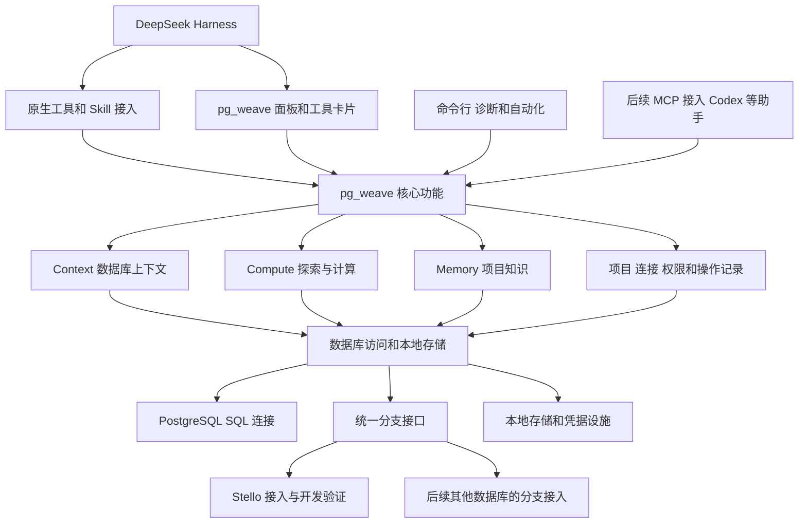

# pg_weave 产品规划

更新于 2026-11-11。

pg_weave 帮助 AI 助手长期参与一个 PostgreSQL 项目：第一次接触时能查清结构，分析问题时能运行 SQL，做实验时能使用数据库分支，下次继续工作时能找到之前确认过的知识。

第一版做成 DeepSeek Harness（下文简称 Harness）的原生插件。用户在 Harness 里配置连接、开展分析和实验、查看结果，并在 pg_weave 面板中审核和整理知识。界面复用 Harness 的设置、导航和工具卡片，不另外做独立 Web 应用，知识保存在本地。

日常操作在 Harness 中完成，命令行作为开发、诊断和自动化的辅助入口。核心功能单独实现，后续再通过 MCP 接入 Codex、Claude Code 等助手。

普通 PostgreSQL 可以直接使用；支持分支的数据库通过单独的接口接入。开发时先用 Stello 验证分支流程，产品本身支持扩展到其他实现。

## 1 帮用户解决什么问题

先围绕一个开发者持续维护同一项目的日常工作，把下面三件事做好：

| 模块 | 用户会怎么问 | pg_weave 要提供什么 |
| --- | --- | --- |
| Context 数据库上下文 | “订单相关有哪些表？这些字段是什么意思？” | 相关表、字段、关系、索引、函数和业务说明，并告诉用户信息来自哪里、什么时候读取的 |
| Compute 探索与计算 | “分析最近 90 天的订单”“试试这个索引有没有用” | 运行 SQL，调用已注册的计算，在数据库中保存并复用中间结果 |
| Memory 项目知识 | “上次为什么建这个索引？” | 找到以前的结论、设计原因和证据，说明它们是否经过确认、现在是否还适用 |

三个模块按任务需要使用。查表结构不必运行计算，回顾设计原因也不必重新做完整调查。

数据库分支为这些工作提供实验环境。支持分支时，pg_weave 可以从选定数据创建独立分支，让 AI 在授权范围内改表、建索引或处理数据；没有分支时，就直接使用当前连接，并明确提示操作会作用于哪个库。

## 2 第一版做到什么程度

| 功能 | 第一版要做到 |
| --- | --- |
| 项目与连接 | 一个项目可连接开发库、测试库、生产库等多个数据库，每次操作都明确目标和权限 |
| 数据库上下文 | 查表、视图、字段、关系、索引和函数，读取数据库注释，补充业务说明，查看已有统计并刷新信息 |
| 数据库分支 | 创建、连接、查看、保留和删除实验分支；数据库支持时，也能释放计算资源、之后再继续使用 |
| 探索 SQL | 在授权范围内查询、修改数据和修改结构，保存执行语句、结果、状态和耗时 |
| 可复用计算 | 用户可以注册常用 SQL 或 PostgreSQL 函数，让 AI 查找并按约定调用 |
| 中间结果 | 保存在数据库中指定的结果区域（Schema），下一步直接引用，不反复把完整数据传给 AI |
| 本地记忆 | 搜索历史知识，提出候选结论，由用户确认、修改、替换或归档，换一次对话仍能使用 |
| Harness 接入 | 原生插件提供上下文、SQL、计算、分支和记忆工具，Skill 说明使用方法，在对话中展示结果 |
| 插件界面 | 在 Harness 中配置项目、连接和权限，查看实验记录，审核和整理知识 |

第一版支持读写，具体范围由数据库账号和项目设置共同限制。在可写实验分支中，AI 可以执行建表、建索引、更新数据等 SQL；在普通数据库上，则按用户给该连接的权限执行。

首版完成后，再通过 MCP 接入 Codex、Claude Code 等助手，并增加团队共享知识、深入关联源码、主动扫描数据分布、异步长任务和其他计算后端。首版先做好单次调用和通过结果引用衔接的多次调用。

### 用户在哪里操作

对话负责发起任务和解释结果，pg_weave 面板负责查看和管理项目数据。面板先提供三个页面：

| 页面 | 用户可以做什么 |
| --- | --- |
| 数据库 | 创建或关联项目，添加和测试连接，选择环境，设置允许的操作，配置分支服务 |
| 实验 | 查看分支来源、执行过的 SQL、运行状态和结果，选择继续使用、释放计算或删除分支 |
| 知识 | 查看候选和已确认知识，核对证据及适用范围，编辑、确认、替代或归档 |

查询和计算的摘要直接显示在对话的工具卡片中，需要查看完整记录时打开对应页面。插件仍需实现这些页面的内容和操作，窗口、导航和工具展示框架由 Harness 提供。[设置扩展](https://github.com/deepseek-ai/deepseek-harness/blob/master/packages/client/ui-settings/README.md)、[面板扩展](https://github.com/deepseek-ai/deepseek-harness/blob/master/packages/client/ui-sidebar/README.md)、[工具卡片](https://github.com/deepseek-ai/deepseek-harness/blob/master/packages/client/ui-tool/README.md)。

## 3 用户怎么使用

### 3.1 连接一个项目

1. 在 Harness 中安装并启用 pg_weave 插件及其 Skill。
2. 打开 pg_weave 的“数据库”页面，创建工作空间（Workspace），为项目取名，可选关联当前 Harness 工作空间和代码目录。
3. 添加数据库连接，设置认证方式、开发或生产等环境标签，以及允许执行的操作。密码等秘密通过凭据设施保存。
4. 点击测试连接，确认实际使用哪个数据库角色、能看到哪些对象，以及数据库版本和扩展。
5. 在 Harness 对话中读取表结构、关系和注释，查看结果与读取时间。
6. 需要使用分支时，再配置对应数据库服务的管理入口和权限，选择从哪个库或分支开始实验。

面板显示当前数据库、分支、环境和权限范围，工具执行前后也说明实际目标。能登录数据库执行 SQL，不代表有权创建或删除数据库分支；这两类权限分别检查。pg_weave 的项目 ID 由自己生成，关联 Harness 工作空间不会改变它。

### 3.2 查清结构和业务含义

用户问：“订单相关有哪些表，它们是什么关系？”

AI 先确定要查哪个库，再搜索相关表，按需要检查字段、外键、索引和业务说明。回答只带上这次问题需要的信息，用户可以顺着来源核对。

回答要区分数据库中的事实和推测。例如，外键可以证明表之间存在约束；字段同名只能作为关联线索。数据库结构以当前系统目录为准，人工业务说明单独保存。统计信息注明读取时间和估计含义，查不到统计不能解释成没有数据。以前的调查结论从 Memory 中查找。

### 3.3 在分支里做实验

用户提出：“验证这个复合索引能否改善订单查询。”

1. pg_weave 根据已有授权，从用户选定的来源创建实验分支，记录来源，以及数据库服务能够确认的数据版本信息。
2. 等分支真正能执行 SQL 后，建立连接。工具卡片和“实验”页面区分“分支已创建”和“可以开始查询”。
3. AI 查看当前结构，执行查询、创建索引或尝试其他修改，记录用过的 SQL 和执行结果。
4. 修改后刷新相关上下文，比较前后结果和执行计划，说明结论的依据。
5. 用户在“实验”页面选择保留分支继续工作，或删除分支。如果数据库支持，也可以只释放计算资源，保留数据供以后使用。
6. pg_weave 保存执行记录，并提出值得留下的候选知识。

一次需要独立保留或丢弃的实验可以使用一个分支。同一分支可以跨对话继续使用；数据库支持时，也能从它再创建子分支。

需要把实验成果用到原库时，先展示可检查的 SQL、迁移建议或分析结论，再按原库的授权执行。不同数据库是否支持分支合并，由各自的接入实现说明。

### 3.4 让多步计算接起来

用户提出：“分析最近 90 天的订单，找出需要排查的异常客户。”

1. Context 找到订单、客户和支付相关的表，Memory 找到用户确认过的“有效订单”口径。
2. AI 查找“客户特征提取”和“异常检测”两项已注册计算，了解参数、输出、版本、权限和执行限制。
3. 在选定数据库或分支中提取特征，把结果存入授权的结果 Schema。
4. 返回结果的位置引用、结构和摘要。异常检测使用这个引用继续计算，完整中间数据留在 PG。
5. AI 读取 Top 20 和必要统计，解释计算规则、时间范围和结果，再提出值得保存的结论。

这种已注册、可以反复调用的计算称为 **Capability**。它说明“能做什么、需要什么输入、会返回什么”，实际实现可以是 SQL 或 PostgreSQL 函数。AI 临时写出的 SQL 也可以保存中间结果，之后再由用户决定是否整理成 Capability。

查到数据库里存在某个函数，只说明它可被发现；要作为计算调用，还需要注册和授权。

### 3.5 把有用的结论留下来

AI 完成调查后，在 Harness 对话里提出候选记忆：结论是什么、适用于哪个库或分支、依据是什么。用户从候选卡片打开“知识”页面，查看证据、编辑内容，再确认或驳回。确认只针对用户看到的那一版内容；Agent 工具可以提出候选和查询审核状态，确认操作由用户在插件界面中完成。

下次对话默认使用经过确认、仍然有效且适合当前任务的知识。记忆保留四种状态：

| 状态 | 使用方式 |
| --- | --- |
| Candidate 候选 | 可以主动查找，但始终显示“未确认” |
| Verified 已确认 | 用户确认后，可在适用范围内作为已确认知识使用 |
| Superseded 已替代 | 有了新结论后保留历史，默认不再使用旧结论 |
| Archived 已归档 | 留作查阅，默认不作为当前知识使用 |

数据库结构变了，要检查相关结论是否仍适用，保留当初的内容和审核记录。实验分支中的发现也不能直接当成所有环境的业务规则。

知识保存在本地，删除实验分支不会把它一起删掉。必要的证据摘要和来源仍然保留；若原始结果已被清理，要明确告诉用户明细已经无法读取。

## 4 需要保存哪些信息

先确定四个核心对象：Workspace、Connection、Capability 和 Memory Item。分支另外记录，因为“访问数据库的连接”和“需要保留或删除的数据分支”有不同的用途和寿命。

| 信息 | 记录什么 | 为什么需要 |
| --- | --- | --- |
| Workspace 工作空间 | 项目 ID、名称、可选代码目录、设置和权限 | 把同一项目的连接、计算和知识放在一起；移动目录不会变成新项目 |
| Connection 数据库连接 | 连接 ID、地址、库名、认证引用、可选分支引用 | 描述怎样访问数据库，凭据本身另行保管 |
| 项目与连接的绑定 | 项目、连接、环境、用途和权限 | 一个项目可以用多个库，同一连接也可以供多个项目使用 |
| Branch 数据库分支 | pg_weave ID、提供方和远端资源引用、来源、数据版本、归属与最近状态 | 知道实验在哪个分支进行，以及哪些分支由本项目管理 |
| Context Object 数据库对象 | 对象引用、所在库或分支、类型、名称、结构指纹和读取时间 | 找到表、字段和函数，并发现结构变化 |
| 业务说明 | 所属项目、对象、内容、来源和修订 | 补充业务含义，与数据库结构事实分开更新 |
| Capability 可复用计算 | ID、名称、版本、说明、输入输出和会修改什么 | 让不同 AI 助手按同样的约定调用计算 |
| Compute Run 执行记录 | ID、项目、目标、SQL 或能力版本、执行人、状态和耗时 | 查清一次探索或计算实际做了什么；临时 SQL 没有能力版本 |
| Compute Result 计算结果 | ID、来源执行、所在目标、存放位置、结构、有效期和状态 | 让下一步复用结果，并检查是否仍能读取 |
| Memory Item 项目知识 | ID、项目、类型、适用范围、内容版本和状态 | 保存结论，并追溯来源、修改和用户审核 |
| Host Binding 助手关联 | 助手类型、实例、工作空间和外部对话或任务引用 | 换一个助手仍能访问同一项目，不拿某次对话 ID 当项目 ID |
| Audit Event 操作记录 | 谁在什么时候，对哪个目标做了什么，是否获准，结果如何 | 追查授权和执行情况，记录中不保存密码等秘密 |

对象关系、统计、计算实现、知识证据、修订和审核记录附属于对应对象。这是逻辑模型，具体存储时不必每项都建一张表。

能力定义与具体 SQL 或函数实现分开保存。已发布的能力版本保持不变，改动后产生新版本，执行记录能追溯实际使用的版本。

pg_weave 为每个分支生成自己的 ID。同名分支删除后再创建，要分配新 ID，当成新资源处理。接入代码同时核对数据库服务返回的资源标识；无法确认是不是原来的分支，就停止相关操作。记录数据版本时使用数据库服务能够确认的信息，不要求所有实现都提供 LSN、CSN 或同一种快照编号。

分支继承了数据，也要重新核对对象、缓存和结果引用，不能直接把父分支里的引用当成新分支自己的引用。

## 5 代码怎么分工

核心功能用独立的 TypeScript 代码实现。数据库上下文、计算、记忆、项目和权限规则都放在这里，Harness 的工具与页面通过接入代码使用这些功能。命令行和后续 MCP 接入也调用同一套核心代码。

首版把工具、界面和 Skill 的职责分清楚：

| 入口 | 负责什么 |
| --- | --- |
| Harness 原生工具 | 向 Agent 提供上下文检索、SQL 执行、计算、分支管理和记忆工具，返回摘要、状态和结果引用 |
| 插件界面 | 配置项目、连接和权限，展示实验与结果，接收用户的知识审核操作 |
| Skill | 说明什么时候查结构、怎样选择目标、怎样使用分支和计算，以及什么时候提出值得保存的知识 |
| 辅助命令行 | 开发调试、连接诊断和脚本自动化，日常使用以 Harness 为入口 |

Harness 接入负责注册工具、提供 Skill，并把插件页面中的用户操作传给核心代码。Skill 提供工作方法，权限检查、执行记录和知识审核规则由 pg_weave 核心代码负责。

接入代码分两类，各自处理自己的变化：

- **助手接入**：第一版通过 Cordis 注册 Harness 工具、服务、Skill 和界面扩展，关联当前项目。后续的 MCP 接入复用相同核心功能，Harness 的类型和调用方式留在适配层中。
- **数据库分支接入**：把统一分支接口（Branch Provider）转换成具体数据库服务的管理请求，取得连接信息并解释返回状态。

核心代码不导入 Cordis、MCP SDK 或某个助手、数据库服务的专有类型。直接连接普通 PG 时，用不到分支接口。第一版可在 Harness 插件进程中运行核心代码，通过存储适配保存本地数据。

分支接口先提供创建、查看状态、取得 SQL 连接和删除。子分支、历史版本选择、暂停、释放计算、恢复和合并是否可用，由接入实现逐项说明。插件界面、工具和辅助命令只提供当前服务和用户权限允许的操作。

每个接入实现还要说明：分支里有哪些数据、能否写入、修改是否与来源隔离、删除会回收什么。暂停、释放计算和删除可能有不同结果，插件界面和工具结果要把区别说清楚。

开发时先接 Stello，用它验证真实的创建、实验、保留和回收流程。Stello 的资源标识和管理协议留在它的接入代码中。比如，它当前创建资源需要使用部署时配置、允许管理写操作的管理员凭据，这只是接入 Stello 时的要求，其他数据库按各自的认证方式处理。

### 数据放在哪里

| 数据 | 存放位置 |
| --- | --- |
| 项目、连接配置、分支关联和能力定义 | 本地存储或用户维护的配置 |
| 密码、令牌等凭据 | 优先使用 Harness 的凭据设施，也可使用用户指定的秘密来源，业务数据只保存引用 |
| 上下文缓存、业务说明、执行记录和结果位置 | 本地存储，按项目、数据库或分支及权限范围区分 |
| 当前表结构和数据库注释 | 从 PostgreSQL 系统目录读取 |
| 计算数据和中间结果 | 当前 PG 或实验分支中获准使用的位置 |
| 知识、证据摘要、修订和审核记录 | 本地知识存储，独立于实验分支保留 |
| 远端分支数据、历史和资源状态 | 由数据库服务管理，pg_weave 查询并保存关联 |

pg_weave 定义项目、知识和执行记录的数据格式，首版通过适配层优先复用 Harness 的本地存储与凭据设施。Harness 管理原始聊天记录；pg_weave 只保存必要的知识证据和来源，不复制整份聊天日志，也不把某次对话当成唯一存储位置。

保存一条知识时，要让内容、证据和审核记录对应同一版本。工具、插件页面和辅助命令访问同一份项目数据，保存时检查版本，避免覆盖用户刚刚审核或修改的内容。存储适配需要验证这一保存方式；重启 Harness 后，已经保存的知识和执行记录仍然可读。

## 6 操作权限和任务收尾

每次执行都检查用户、项目、目标库或分支、操作类型，以及允许返回的数据。已有授权范围内不用每条 SQL 都重新确认，超出范围才请求新的授权。密码和管理令牌不出现在 AI 能读到的结果中。

需要用户批准的工具操作使用 Harness 的批准交互，pg_weave 核心和数据库角色继续检查实际权限。批准执行一条 SQL 与确认一条知识分别记录，前者不会自动把分析结论变成已确认知识。

在实验分支里的写权限只用于那个分支。数据库分支也不保证所有资源都独立：查询可能仍共用 CPU 和存储；SQL 或函数如果触发了外部网络请求、对象存储写入，删除分支不会撤销这些影响。

| 操作或情况 | 用户应该看到什么 |
| --- | --- |
| 保留分支 | 下次对话还能找到并继续使用这个实验环境 |
| 释放计算资源 | 仅在数据库支持时提供；确认释放成功后，分支数据仍然保留 |
| 删除分支 | 删除的是指定的远端资源，本地执行摘要与知识保留，原分支结果标为无法读取 |
| 清理中间结果 | 只删除已经登记、能够确认归属的结果，不删除业务对象 |
| 分支或查询超时 | 说明只是停止等待，还是远端操作已经结束，并提供状态查询 |
| 操作结果不确定 | 继续核实原请求，不通过新建同名分支或重复写入来猜测是否成功 |

用户选择是否保留或删除分支；自动删除期限另行商定。删除只针对 pg_weave 管理且身份明确的资源，不能根据名称前缀批量删库或分支。

结果引用指向一次已保存的结果。重算产生新引用，不能悄悄换成另一份数据。第一版只在同一个库或分支内衔接计算，每次使用都重新检查权限和有效期；结果过期或原分支删除后，明确提示无法使用。清理时避开正在使用的结果，父分支的引用也不能直接拿到子分支里使用。

第一版先做好有执行时限的调用、状态查询和取消，执行记录由 pg_weave 保存。SQL 连接断开不能证明事务没提交，不能据此自动重跑写入。进程意外退出后，先核实未结束的操作；后续做异步任务时，再解决重启后怎样继续执行的问题。

## 7 按什么顺序开发

先把项目、连接、能力、记忆和分支之间的关系定清楚，再做 Context。同时尽早在 Harness 中接入真实工具、插件页面和数据库，确认设计确实能用。

| 阶段 | 做什么 | 怎样算完成 |
| --- | --- | --- |
| 跑通接入 | 确定核心对象，做 Harness 原生插件、Skill 和最小配置页，验证存储与凭据适配，并做分支接口和 Stello 接入 | Harness 能发现并调用工具；插件页面与工具使用同一项目；能核对权限、辨认资源和核实原操作；记录支持的 Harness 版本 |
| 看懂数据库 | 多连接、对象搜索、表关系、注释、业务说明和刷新 | 新接一个 PG 就能解释相关结构，能分清不同环境，读不到或过期的信息说明原因 |
| 完成一次分支实验 | 创建和连接分支，执行 SQL，查看结果，保留或删除 | 用 Stello 跑完一次可写实验，验证修改隔离、失败处理和它支持的计算释放与恢复 |
| 复用计算和知识 | 注册 SQL/函数、衔接结果、本地记忆审核和搜索 | 两步计算能接起来；用户在插件页面确认的结论，在新的 Harness 对话里能找到 |
| 完成首版 | 补齐数据库、实验、知识三个页面，以及工具卡片、权限、操作记录和清理流程 | 在 Harness 中从配置连接到审核知识完成整个任务；普通 PG 和分支路径均能使用，并正确处理失败 |

首版在 Harness 中完成两个例子：在普通 PG 上分析订单，在插件页面审核并保存知识；通过统一分支接口，在实验分支中验证索引或结构修改，开发时使用 Stello。

发布前检查权限与项目隔离、分支隔离、同名分支重建、结构变化、误用候选知识、撤销权限、超时、未知结果以及删除后的引用失效。数据库支持计算释放与恢复时，还要验证释放后可以继续使用。

性能按实际环境测量，记录数据库和接入版本、数据规模、创建分支到第一条 SQL 可执行的时间、查询耗时、传给 AI 的数据量，以及资源是否真的释放。速度和容量根据测量结果说明。
