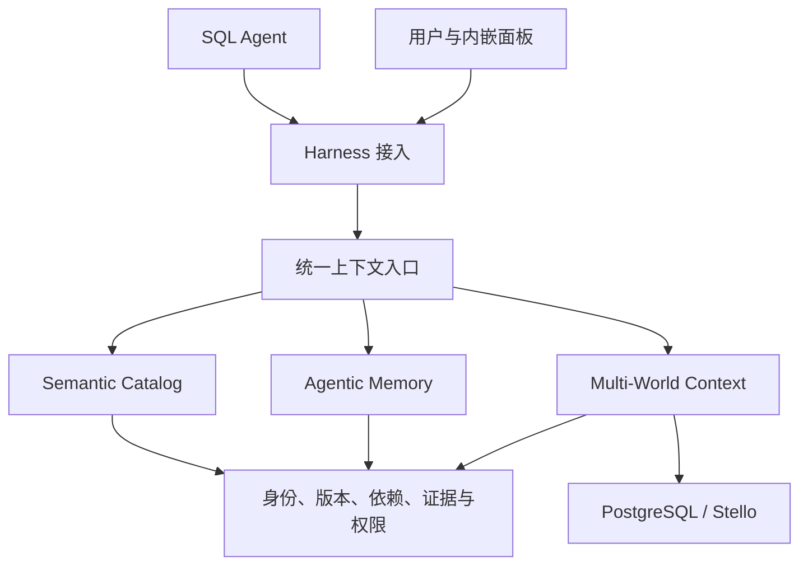

# Stellane · Agent Data Context

## 产品目标

为 SQL Agent 提供统一的数据上下文，使其更准确地理解业务数据、复用探索经验，并安全地尝试不同的数据状态。面向通用业务分析与 SQL 探索。

Agent 负责理解问题、选择假设、编写 SQL、解释结果和决策。Stellane 提供有来源的语义信息、可复用的探索知识、隔离的数据状态，以及权限与有效性检查。

Core 保持独立，首个接入为 DeepSeek Harness 本地插件，运行在 Host 内，使用其对话与 Agent 执行能力。内嵌面板展示配置、上下文、分支、证据和有效性状态。

## 核心能力

### Semantic Catalog · 语义目录

在数据库元数据之上，管理表与字段的业务含义、单位、数据关系、指标口径、常用计算规则和 SQL 示例。

每项语义记录来源、版本、关联的数据对象和适用条件。数据库注释、用户文档和 Agent 提议保留各自来源；未经证据支持的推断不能直接作为业务定义。口径或结构变化时创建新版本，并重新检查依赖它的知识与结果。

语义目录提供定义和使用依据；具体问题怎样查询与计算，由 Agent 决定。

### Agentic Memory · 探索记忆

积累数据库背后的业务实体、行粒度、隐性键、关联基数和数据血缘。例如一张明细表一行对应什么，两张表用哪些字段关联，一个汇总视图依赖哪些上游对象。每条发现关联对象、证据、观测范围和数据状态。

数据库声明的结构关系来自目录，数据中发现的关系来自实际观测，业务含义来自有来源的业务说明。保留各自证据，供 Agent 结合问题判断。

记忆采用全自动流程。Agent 在探索中提炼发现并关联证据，系统自动验证、确定共享范围并发布；后续根据新证据和数据变化更新、替代或使其失效。

系统核对隐性键的唯一性、关联的匹配覆盖和行数放大风险。数据匹配只能证明观测范围内的关系，业务语义仍需业务来源。可变数据上的发现使用前重新核对，结构或权限变化后排除受影响的知识。

### Multi-World Context · 多分支上下文

复用 Stello 等提供方的数据库分支能力，从明确的数据状态创建独立探索路径。只读探索可共享数据状态，需要独立修改时再派生分支。

分支记录不可替换的资源身份、父状态和实际固定位置。已提交的持久数据与中间结果可以继承；未提交事务、临时表和外部副作用不属于数据库分支继承范围。

语义与记忆通过版本引用共享，各分支的新假设、私有笔记和结果单独记录。子分支只继承能证明仍适用的知识；共同祖先或相同表名不足以证明适用。子分支中的发现经验证和发布后，其他分支还须按各自状态判断能否复用。

### 统一上下文管理

统一检索入口接收当前主体、数据状态与问题，返回业务说明、关系和血缘，并标注证据与适用性。

| 对象 | 必要信息 |
| --- | --- |
| 数据状态 | 数据源身份、实时或固定状态、分支身份与来源位置、可用的结构及数据版本证据 |
| 上下文记录 | 类型、内容、版本、作者或导入来源、共享范围、适用条件与依赖 |
| 验证证据 | 数据库目录或只读验证、执行记录、观测范围和时间 |
| 使用判定 | 对当前目标适用、待验证或失效的原因，以及需要补充的验证 |

发布状态（候选、已发布、已替代、已归档）与有效性（适用、待验证、失效）独立。记忆在一个分支上有效，并不意味着它在所有分支上都有效。

有效性按依赖判断。业务定义依赖相关对象结构和来源，血缘依赖数据库目录，隐性关联还需要核对实际数据。

首版采用保守判断：有依据证明依赖保持不变时才复用，依赖变化则重新验证。无法观测外部写入、依赖不完整或版本不足时标为待验证。实时库的执行时间和固定切面的版本分别记录。

## 界面与产品交互

日常分析从项目里的普通 Harness 对话开始。Harness 里的 Stellane 插件自动提示 Agent 按需加载数据 Skill，利用已授权的数据环境查阅语义目录和执行只读查询。Stellane 工作台用于查看运行和证据、管理数据源与语义资料，以及处理需要独立分支的实验。

### 页面与对象

数据源是项目接入的 PostgreSQL 或 Stello 来源。数据环境是一次操作可使用的目标，界面显示「实时只读」「固定只读」或「可写分支」。任务记录要验证的目标、初始环境、获准参与的 Agent、工作分支和结果。交付结果引用固定切面、方案摘要和验证记录，任务结束后仍可按保留范围打开。

| 入口 | 用户在这里做什么 |
| --- | --- |
| 探索 | 选择环境并手动执行 SQL、查看完整执行历史，或预览资料并开启绑定到指定环境的对话。Stello 环境可从这里创建实验。 |
| 数据目录 | 按当前环境查看表、字段、业务口径、关系与血缘。从对象详情添加说明或带着对象去提问。业务说明、数据库声明和 Agent 观察分别展示来源。 |
| 任务与结果 | 工作台首页。查看近期执行、实验进度、待处理操作和固定交付。点击执行记录可打开对应环境的 SQL、预览和证据。任务详情提供继续对话、查看环境、比较结果、结束和清理入口。 |
| 数据源 | 从工作台的设置入口集中管理连接、所在项目和凭据引用。测试连接、查看实际目标及可用能力，进入该来源的查询环境。 |

探索和目录共用环境栏，显示来源、环境名称和读写状态。任务与结果按项目浏览，进入具体任务或证据后显示其绑定环境。从对话打开证据时定位原记录。当前环境失去访问权限或被移除时保留原上下文，提示用户重新选择目标。

### 从接入到交付

1. **接入数据。** 测试并保存连接后，进入默认只读环境。PostgreSQL 和 Stello 走同一个入口，表单按连接类型展示字段。目录可在接入后补充，能够读取元数据就可以开始提问或查询。连接失败时保留表单和原目标，显示可采取的下一步。
2. **提问和查证。** 在项目的普通 Harness 对话直接提问。项目有可用数据时，Agent 可加载 `stellane-data`，发现已授权环境、核对业务定义和表关系，再执行只读查询。候选来源有歧义时在对话里澄清。需要固定范围时，可从「探索」打开绑定到所选环境的对话，后续追问沿用该绑定。Core 按实际项目和会话身份校验每次访问。对话中可看到工具调用和结果，在「任务与结果」打开执行证据。
3. **开始实验。** 用户在普通对话说明要验证的假设或模拟的改动。Agent 确认 Stello 来源和范围，固定已提交状态，从该基线创建独立工作分支并执行验证。任务通过创建实验的会话授权，普通对话在实验结束后可以继续查询项目来源。「任务与结果」持续显示准备、执行与交付进度，并能返回原对话。普通 PostgreSQL 支持只读探索。
4. **交付和比较。** 从任务交付当前方案时保存固定切面、摘要和只读证据，父任务可直接在「任务与结果」打开。比较页展示两个方案的基线、结论和可比较指标，指标的口径、单位或来源不同则并列展示各自证据并提示差异。固定切面的证据查询失败时显示已保存的切面，后续针对原切面补查。生产采纳由业务系统按自身规则执行。
5. **结束和复用。** 对话发起的实验通常在固定交付后清理临时分支。用户要求继续在原工作分支验证时可暂缓清理。清理撤销任务分支访问，保留固定切面和执行证据；受阻时可按原操作核对或续做。已验证并获准共享的发现进入数据目录，后续任务在查询时读取适用证据或对待复核观察重新验证。

### 权限、状态与证据

| 场景 | 界面反馈与动作 |
| --- | --- |
| 资料缺失或过期 | 显示相关对象和缺失原因。业务说明由有权限的用户更新，Agent 发现按共享范围自动验证。实时或可写环境中的历史观察标为「使用前核对」，与适用于固定切面的已验证观察分开显示。 |
| 准备、运行或超限 | 使用同一任务记录展示派生、查询和交付的进度。超限时说明受影响的范围，并可查看占用或待核实任务。结果截断时明确显示为预览。 |
| 写入、派生或清理结果待核实 | 从原任务或结果进入「核对原操作」。核对沿用原资源身份和操作标识，写入以事务回执判定。结束任务时保留核对所需的资源，按核对结论继续清理或修复。 |
| 权限变化或数据目标失效 | 禁用受影响的动作并说明原因。私有分支、SQL、记忆与结果按各自授权显示，交付权限只覆盖约定的接收目标。 |

对话工具卡片、SQL 结果、目录证据与任务活动引用同一组记录。默认显示用户能据此判断的状态、范围和结果，资源 ID、LSN、角色与完整记录可在详情中查看。窄面板使用列表到详情的导航，结果表可横向滚动，关键操作保留键盘入口和文字状态。

跨表正式指标采用已保存的连续等值关系链，支持分组计数、可选数值求和和等值筛选。Core 在同一 PostgreSQL 语句快照内得到匹配覆盖、缺失与歧义数量、分组和总量。无法归因的记录保留在总量和单独分组。目标键多义、金额缺失或证明不完整时，结果标为待核实。指标证据记录实际口径版本和引用的关系，业务定义可由数据负责人维护。

对话可直接打开执行证据。实时关系失效详情并列展示原验证与本次复核，均可打开记录。从异常指标进入试算对话时，任务记录原执行 ID，并用原指标口径计算固定基线和独立分支固定结果，展示覆盖率、分组和总量变化。

### 首个联调验收

用一个真实 Harness 项目完成从连接到收尾的演练。用户接入 PostgreSQL 后能直接完成只读查询。从 Stello 开始另一项实验，由两个子任务从同一基线验证不同更新方案，父任务比较固定结果。切换环境和重新打开对话时，已有对话仍指向原数据范围。用同项目的未授权 Agent 测试私有数据和证据不可读。模拟提交响应丢失和清理中断，用户能从任务详情核对原操作，最终归还工作分支额度并打开保留结果。记录探索 SQL、复核成本和分支开销供后续对照。

## 产品结构

## 当前实现与开发顺序

当前代码提供 SQL 与分支基础：PostgreSQL 只读查询、Stello 固定与派生、工作分支 DDL / DML、固定结果交付、项目访问检查、事务回执和未知操作核对。环境对应数据状态，执行与交付记录提供证据基础。

已实现语义目录初版和统一上下文入口：记录数据源、环境、实际目标、结构与目录指纹、来源证据；支持表单录入、JSON 批量导入、版本更新、历史查看和元信息变化后的排除。当前语义依赖按整表元信息核对，定义的业务含义来自记录的来源，SQL 示例尚未经系统自动验证。

已实现数据关系与血缘初版。自动读取视图与物化视图的直接依赖，标注上游被引用的列。Agent 提出行键或相等关联后，系统检查空值、唯一性和匹配覆盖，验证通过即共享给同环境的 Agent。历史观察关联相关对象和执行证据，数据变化后可重新核对。

已接通工作台的单任务实验流程。用户可从 Stello 环境创建任务、进入 SQL 或绑定的 Harness 对话、固定一份方案并清理任务分支。任务根对话按实际环境授权。后续补齐子任务授权和多方案比较。

普通 Harness 对话已接入数据 Skill，项目接入 PostgreSQL 或 Stello 后可以直接查目录、执行只读查询。接入 Stello 后还可在普通对话创建、交付和清理单任务实验。同项目其他会话不能使用私有工作分支或读取任务结果，拥有者可以在工作台跟踪并处理任务。

| 顺序 | 交付 | 验收重点 |
| --- | --- | --- |
| 1. 统一上下文基础（初版完成） | 关联来源身份、环境、观测或固定位置、定义版本、结构依赖与证据；提供统一检索入口 | 环境身份不能串用，结构观测与数据内容版本分开记录 |
| 2. 语义目录（初版完成） | 元数据读取、业务说明与 SQL 示例的导入、版本管理和检索 | Agent 能找到正确口径、对象关系及其来源 |
| 3. 探索记忆（关系与视图血缘初版完成） | 自动读取直接血缘，验证并共享隐性键与关联 | 第二个 Agent 找到关联列、基数、来源和适用范围 |
| 4. 任务级分支授权与回收 | 绑定任务、Agent 和分支身份。对环境发现、SQL、上下文、派生、结果交付和操作核对执行任务级授权。通过 Stello 精确分支授权、撤销、释放与删除接口回收任务资源，持久保存原操作标识以支持续做 | 同项目兄弟任务无法访问对方的私有环境和结果。创建、提交或清理响应丢失后，通过原资源身份与回执恢复，确认无重复创建或写入、工作分支额度归还、固定交付仍可查 |
| 5. 跨分支探索记忆 | 先复用共享的行键和等值关联观察。读取时核对授权、来源切面、依赖对象和验证证据。固定状态有证据时可直接复用，可写分支上的继承观察在目标环境复核后使用 | 父任务的共享发现可被授权子任务找到。一个分支的数据或权限变化会排除相关观察，兄弟分支可独立验证。私有发现只在授权范围内可见 |
| 6. 真实 Agent 联调与测量 | 由 Harness Agent 从同一固定切面派生两个任务，各自验证方案，由父任务比较固定结果。对照有无探索记忆，并测量 Stellane 工具和 Stello 分支的开销 | 核对独立预期答案和隔离结果，记录探索 SQL 次数、复核成本、首条真实 SQL 延迟、业务尾延迟、超限响应和资源归还 |

单任务流程已有原对话和面板两个入口。后续工作包括子任务授权、跨分支记忆和多方案比较。

Stellane 负责任务身份、访问范围、记忆适用性和联调，Stello 提供分支身份、固定位置、授权和资源操作。Stello 的 PG14 共享负载专项沿其现有计划推进。联调确认需要调整底层接口或契约时，在 Stello 登记具体任务。

### 后续扩展

- 在首个宿主中把任务检查点关联到数据切面与原操作回执，验证断点续跑。面向生产部署时，补齐 Stellane 状态恢复和跨 Host 可用性验收，并结合 Stello 的独立故障域恢复证据。
- 依据真实目录规模补齐按需读取，继续扩展实体与字段映射、列级转换血缘、外部任务血缘，以及记忆的保留、归档和删除。
- 有第二个 Agent 宿主时接入 MCP。有可复现的召回缺口或文档、图像查询需求时，再评估混合检索与多模态接入。

## 验收原则

测试使用通用数据集与可替换的业务语义，问题拆解、SQL 和方案选择由 Agent 完成。验证器根据独立的预期结果检查正确性，不向 Agent 预置固定决策路径。

分别测量语义信息对查询正确性的帮助、记忆对重复探索与查询次数的减少、错误复用的拦截，以及分支的隔离和资源开销。按需移除某项上下文能力作对照，区分语义、记忆、分支各自的作用。

必须覆盖记忆自动发布与失效、不同 Agent 与分支间的访问范围、语义或数据变化后的失效、依赖未知时的保守处理，以及结果固定、重启与未知写入不重放。

首版范围为 PostgreSQL、单个 Host 和授权范围内的上下文共享。向量检索作为检索实现选项，按实际需要引入；生命周期和规模优化服务于上下文正确性与可用性。
