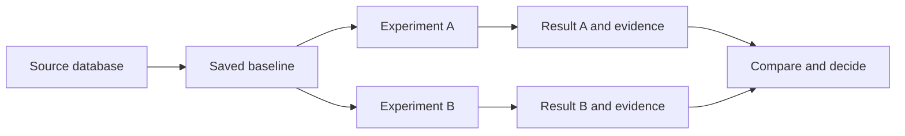

# Stellane

**Understand your Postgres data. Explore different paths. Keep the evidence for every result.**

Stellane is a DeepSeek Harness plugin for asking questions and testing ideas in ordinary chat. It helps the Agent understand tables, remember verified relationships and revisit them when data changes. With Neon branching or Stello, the Agent can try alternative changes on separate database branches, compare their results and keep the source unchanged through Stellane.

Multiple trial paths are central to Stellane: start from a common baseline, let each idea develop independently, then make a decision with evidence. The side panel shows sources, memory, SQL, experiment progress and retained results.

[中文说明](README.zh-CN.md) · [Try the demos](examples/README.md) · [Branch experiment walkthrough](docs/experiments.md) · [Product decisions](PRODUCT.md) · [Development and testing](DEVELOPMENT.md)

## When it helps

| Situation | What you do with Stellane | What you gain |
| --- | --- | --- |
| You inherit an unfamiliar database | Ask how tables relate; inspect definitions and view lineage | An explanation backed by the actual schema and queries |
| Several analyses need the same joins | Find and verify relationships once, then retrieve and recheck them in later chats | Less repeated exploration, with evidence of whether old knowledge still applies |
| A report silently drops records after data changes | Check relationship coverage and inspect failed observations | Missing records remain visible in totals and the reason is traceable |
| A mapping could be repaired in more than one way | Try A and B on separate branches from one baseline | Comparable results without mixing the two proposed repairs |
| You want to test an allocation rule or a schema change | Change data, tables or views in an experiment and run verification queries | A measured result before deciding whether to adopt the change elsewhere |

These features work with your schema. Stellane has no built-in sales, finance, telemetry or support model. The Agent chooses the queries and proposed changes; Stellane checks access, validates supported claims and retains execution evidence.

## One baseline, several paths

A useful experiment asks more than “did this SQL run?” It asks “what changes under this hypothesis, compared with the same starting data?”



1. **Save one baseline.** A and B use the same starting point, instead of taking separate samples of a moving source.
2. **Give each idea its own branch.** A mapping repair, data update or schema change in A does not become part of B.
3. **Measure both with the same definition.** Compare totals, coverage, group changes and the relevant SQL evidence. Two variants can both eliminate missing joins while assigning records differently; complete coverage alone does not establish which business rule is correct.
4. **Keep the results and end the trials.** Temporary resources are cleaned up or reported as retained dependencies. Choosing a result does not automatically apply it to production.

For example, ask in one ordinary chat:

> Save a common baseline. In separate experiments, test mapping hypothesis A and mapping hypothesis B using the rules I supplied. For each, report the same metric, unmatched records and changes by group. Compare both with the baseline, retain the evidence, and leave the source unchanged.

The current workflow supports separately named experiments from a shared baseline. Run the variants in the same conversation and compare their saved results there; inspect each task in the panel. Automatic multi-Agent scheduling and a combined multi-variant comparison screen are future work. The [branch walkthrough](docs/experiments.md) provides concrete data, prompts, expected results and cleanup steps.

## Choose your connection

| Connection | Queries, definitions, view lineage and relationship memory | Isolated write experiments |
| --- | --- | --- |
| PostgreSQL | Yes | Requires a branching provider |
| Neon connection URL | Yes | Add Neon API access to enable |
| Neon with API access | Yes | Experimental; cloud validation pending |
| Stello | Yes | Yes |

**A Postgres connection is enough to start.** Analysis and memory do not require Docker, Stello or a Neon API key. Use branching when a question needs an isolated change to data or schema; a read-only question can stay on the source connection.

Stellane uses the provider's database branching rather than implementing its own copy engine. Stello provides fixed data states. Neon provides branches that Stellane treats as read-only baselines and results; an external administrator can still change them. Neon results can depend on retained parent branches. The panel reports that retention, and those resources may incur Neon charges. Branch startup time and resource cost depend on the provider and workload.

## Install from source

This is a development version. Use a local checkout; these instructions do not assume a published npm release.

Prerequisites: Node.js **24.9+**, pnpm **11.1.2** through Corepack, and DeepSeek Harness **0.2.2-rc.1** with a working model connection. The panel currently targets Harness Web.

```sh
git clone https://github.com/czNail/Stellane.git
cd Stellane
corepack pnpm install
corepack pnpm check
dsh plugin --profile web add "$PWD"
```

Restart the Harness Web Host after installing the plugin. If you start it from a terminal, stop the existing process and run:

```sh
dsh web
```

Harness opens the browser and prints its address. For a remote Host, use `dsh web --no-open` and your existing way of accessing that Host. Install the plugin in the same profile you run.

## Try it without your own data

The repository includes small synthetic datasets, example questions, deliberate data changes and independently checkable expected results. You can see a relationship discovered, reused in a new chat and invalidated after a change, then test two repair paths with a branching provider.

With Docker running:

```sh
corepack pnpm demo start
corepack pnpm demo status
```

Follow the printed project and private connection-file instructions, then use the [step-by-step demos](examples/README.md). The local Postgres demo covers analysis and memory. The branch walkthrough additionally needs a configured Neon or Stello test source; starting the local demo does not create a cloud project.

Use `corepack pnpm demo stop` when finished. Reset, data-change and provider setup instructions are in the demo guide. The helper manages its own labeled demo resources.

## Connect once, then chat

1. Open **Stellane → 数据源 (Data sources) → 添加数据源 (Add data source)**.
2. Select PostgreSQL or Neon, paste the connection URL and confirm the project directory. The current Harness project is filled in when available; the name defaults to the database name. The database itself may be remote.
3. Click **连接并开始使用 (Connect and start)**. Stellane tests the connection, stores credentials in a private file on the Host, and creates a read-only environment.
4. Open a normal chat in that project and ask a question. The bundled `stellane-data` Skill guides the Agent to the connected data; no separate Stellane chat is required.

Example prompts — replace the object names with your own:

> What tables are available, and how are they related?
>
> Count events by region. Check the join and show records that cannot be attributed.
>
> In a new chat: calculate another metric using the relationship we found. Verify that it still holds.

Multiple relevant sources? Name the one to use in the conversation. Business definitions are optional; add them under **数据目录 (Data catalog)** when a term needs an agreed meaning.

For Neon experiments, select **启用独立试验 (Enable isolated experiments)** when adding the source and provide its project ID, branch ID and API key. For Stello, use its exported client configuration and source branch. You can then request a single trial or multiple named trials from a shared baseline. See [experiments](docs/experiments.md) for the exact workflow and provider differences.

## Where to look

| Panel | Purpose |
| --- | --- |
| 任务与结果 · Activity and results | Recent runs, experiment progress, evidence and results. Return to the original conversation. |
| 数据目录 · Data catalog | Tables, definitions, view lineage and saved relationship observations, including failed rechecks. |
| 探索 · SQL exploration | Run SQL manually or open a conversation bound to a specific environment. |
| 数据源 · Data sources | Add connections and see which capabilities each provides. |

You can stay in chat for daily work. Open the panel when you want to inspect or manage what happened.

## Current scope

- Memory covers verified row keys and equality joins. View lineage comes from Postgres metadata. It does not yet model every output-column transformation or external ETL job.
- Saved data matches are observations, not proof of business meaning. Live data and Neon branches require fresh checks before reuse; Stellane does not continuously watch external writes.
- Structured metrics support a chain of equality joins, grouped row counts, optional numeric sums and one equality filter. Other calculations use ordinary read-only SQL with their own execution evidence.
- Source connections are read-only through Stellane. Writes are restricted to plugin-created experiment branches. Use a database role with the access you want to grant.
- State and evidence live on one Harness Host. Distributed hosting, general multi-Agent experiment scheduling and automatic production adoption are outside the current scope.

PostgreSQL and Stello have real-database integration tests. Neon branching is experimental: its API contract tests pass, but cloud end-to-end validation has not yet been run. An opt-in `test:neon:live` suite is available for a dedicated Neon test project. See [the test guide](DEVELOPMENT.md#检查与验收) for requirements and coverage. Demo outputs illustrate behavior on synthetic data, not a promise of production accuracy or speed.
