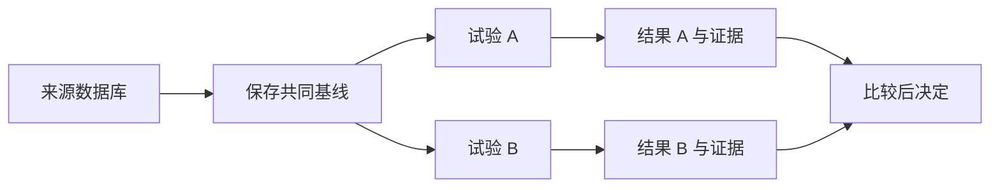

# Stellane

**理解数据，探索多条路径，为每个结果留下证据。**

Stellane 是 DeepSeek Harness 的数据插件。用户在普通对话里提问或提出试验想法，Agent 查阅表结构、复用经过验证的关系，并在数据变化时重新核对。配合 Stello，还能把不同改法放到独立数据库分支中，比较结果，同时让 Stellane 保持来源库不变。

多条试验路径是 Stellane 的核心思路：从共同基线出发，让不同假设分别展开，再依据结果决定下一步。侧边面板展示来源、记忆、SQL、试验进度和保留的结果。

[English](README.md) · [跟着演示上手](examples/README.zh-CN.md) · [分支试验教程](docs/experiments.zh-CN.md) · [产品设计](PRODUCT.md) · [开发与验收](DEVELOPMENT.md) · [安装、升级和卸载](docs/install-and-maintain.zh-CN.md) · [数据与隐私](docs/data-and-privacy.zh-CN.md)

## 什么场景有帮助

| 遇到的情况 | 怎样使用 Stellane | 能得到什么 |
| --- | --- | --- |
| 接手一个不熟悉的数据库 | 询问表关系，查业务定义和视图血缘 | 有真实结构与查询依据的说明 |
| 多次分析都要用同一批关联 | 第一次验证并保存，后续对话检索并复核 | 减少重复探索，知道旧结论现在还能不能用 |
| 数据变化后，报表悄悄漏掉一些记录 | 检查关联覆盖，打开失效观察 | 缺失记录保留在总量中，原因可追溯 |
| 一条错误映射有不止一种修法 | 从同一基线开 A、B 两个独立试验 | 两种修法各有结果，互不混入，便于比较 |
| 想调整分配规则或改表结构 | 在试验里改数据、表或视图，再执行验证查询 | 采用改动之前，先看到实际影响 |

功能面向通用表结构，产品没有预设销售、财务、设备或工单模型。Agent 负责选择查询与改动方案，Stellane 负责访问范围、受支持关系的验证和执行证据。

## 一个基线，多条试验路径

有价值的试验要回答「这个假设让结果发生了什么变化」，因此需要共同的起点和一致的比较口径。



1. **保存一次共同基线。** A、B 从同一份起始数据出发，避免把实时库两次采样的差异混入方案差异。
2. **每个想法有自己的分支。** A 的映射修复、数据更新或结构修改不会进入 B。
3. **按相同定义计算。** 对比总量、覆盖、分组变化和 SQL 证据。两种修法可能都消除了未匹配记录，却改变了不同的归属；完整覆盖本身不能证明哪条业务规则正确。
4. **保留结果，结束试验。** 临时资源按提供方能力清理，必要的保留依赖会明确说明。选定结果不会自动把改动应用到生产库。

可以在同一个普通对话里这样说：

> 保存一个共同基线。按我提供的规则，分别开试验验证映射假设 A 和假设 B。用相同指标比较两者与基线的差异，包括未匹配记录和分组变化。保留各自证据，来源库保持不变。

当前可以从共享基线创建不同名称的试验，在同一对话中分别运行、读取保存的结果并比较，面板查看各个任务。自动多 Agent 调度和统一的多方案比较页仍是后续工作。[分支教程](docs/experiments.zh-CN.md)提供具体数据、提问、预期结果和收尾步骤。

## 用什么数据库

| 接入方式 | 查数据、看血缘、保存与复核记忆 | 独立写入试验 |
| --- | --- | --- |
| PostgreSQL | 支持 | 需分支提供方 |
| Neon 连接 URL | 支持 | 仅有 URL 不提供分支管理 |
| Docker 自托管开源 Neon | 支持 | [实验性本地控制器](docs/local-neon.zh-CN.md)，完整运行验收待完成 |
| Neon 云 API | 支持 | 实验性适配，不属于本次云端验收范围 |
| Stello | 支持 | 支持 |

**普通 PostgreSQL 就可以开始用。** 分析和记忆无需 Docker、Stello 或 Neon API key。需要隔离修改数据或结构时再使用分支，纯只读问题可以直接查询来源库。

Stellane 使用提供方的数据库分支能力。Stello 提供固定数据切面；Neon 的基线和结果是由 Stellane 限制为只读的分支，外部管理员仍可能修改它们。保留 Neon 结果可能需要同时保留父分支，面板会说明原因。本地 Docker 时间线占用磁盘，云端账户则可能继续计费；Neon 采用不依赖付费云账户的自托管路线，目前完整运行验收尚未通过。分支启动时间和资源开销取决于提供方与实际负载。

## 安装

Stellane 0.1.0 需要 Node.js **24.9+**、DeepSeek Harness Web **0.2.2-rc.1 至 rc.3** 和可用的 DSH 模型连接。安装已在 Linux 实测。

```sh
dsh plugin --profile web add @stellane/harness-plugin@0.1.0
```

重启该配置的 Web Host，从侧栏打开 Stellane。面板支持中英文切换。归档安装、备份与卸载见[安装与维护](docs/install-and-maintain.zh-CN.md)。

### 从源码开发

开发者另需通过 Corepack 使用 pnpm 11.1.2：

```sh
git clone https://github.com/czNail/Stellane.git
cd Stellane
corepack pnpm install
corepack pnpm check
dsh plugin --profile web add "$PWD"
```

源码改动后重新构建并重启对应 Host。更多开发和发布检查见 [DEVELOPMENT.md](DEVELOPMENT.md)。

## 没有自己的数据，也可以先体验

仓库提供小规模合成数据、示例提问、可控的数据变更和可独立核对的预期结果。可以依次体验关系发现、新对话复用、变更后失效，再配合分支提供方比较两条修复路径。

启动 Docker 后执行：

```sh
dsh plugin --profile web exec stellane-demo start
dsh plugin --profile web exec stellane-demo status
```

按命令输出的项目目录和私有连接文件说明接入，再跟着[演示步骤](examples/README.zh-CN.md)操作。本地 Postgres 演示覆盖分析和记忆；要体验独立分支，接入专用 Stello 测试来源。

结束时执行 `dsh plugin --profile web exec stellane-demo stop`。在源码目录中，对应命令仍是 `pnpm demo start`、`status` 和 `stop`。重置、变更数据和接入分支提供方的方法见演示指南。脚本只管理带自身所属标记的演示资源。

## 接一次库，之后直接聊天

1. 打开 **Stellane → 数据源 → 添加数据源**。
2. 选择 PostgreSQL 或 Neon，粘贴连接 URL，确认项目目录。有当前 Harness 项目时会自动带入目录，名称默认使用数据库名。数据库可以在远端。
3. 点击 **连接并开始使用**。插件会测试连接、将凭据保存到宿主私有文件，并自动创建只读环境。
4. 在同一项目里打开普通对话，直接问问题。内置 `stellane-data` Skill 引导 Agent 使用已接入的数据，无需单独开一种 Stellane 对话。

可以这样问，将表名和字段换成自己的：

> 看看有哪些表，它们之间有什么关系？
>
> 按区域统计事件数，核对关联，列出无法归因的数量。
>
> 新开对话后：用上次发现的关联算另一个指标，先检查它现在还成立吗。

有多个可能匹配的数据源时，在问题里说明使用哪一个。只有业务术语需要约定口径时，才需要去 **数据目录** 补充业务说明。

做分支试验时，选 Stello 并提供导出的客户端配置和来源分支。本地及云端 Neon 分支入口仍为实验性能力，不属于 0.1 验收范围。之后可以请求单次试验，也可以从共享基线开展不同名称的试验。[分支教程](docs/experiments.zh-CN.md)解释具体步骤和提供方差异。

## 面板什么时候用

- **任务与结果**：看查询和试验进度，打开证据，返回原对话。
- **数据目录**：看表、字段、业务说明、关系与血缘，包括旧关系为何失效。
- **探索**：需要时手写 SQL，或把对话绑定到指定环境。
- **数据源**：接入数据库，查看连接及可用能力。
- **管理与清理**：停用访问、更新凭据、归档记忆、回收保留分支，以及删除本地资料。

日常分析可以一直留在聊天里。

## 当前范围

记忆目前支持经过数据验证的行键和等值关联，血缘来自 PostgreSQL 的视图依赖。列级转换、外部 ETL 血缘还未覆盖。数据匹配说明观测到的关系，业务含义仍需要业务依据。

实时库和 Neon 分支上的观察使用前需要复核，插件没有持续监听所有外部写入。跨表指标工具支持连续等值关系链、分组计数、可选数值求和和一个等值筛选；其他计算由 Agent 使用普通只读 SQL，并保留执行证据。

来源连接在 Stellane 中只读，写入仅发生在插件创建的试验分支。状态与证据保存在单个 Harness Host，当前未提供分布式部署、通用多 Agent 调度和自动生产采纳。

0.1 的验收路径是 PostgreSQL 查询和 Stello 分支试验。本地和云端 Neon 分支均暂不做运行验收。Docker 自托管路线使用真实开源 Neon 服务和 Stellane 本地开发控制器，不依赖付费云账户。具体步骤和覆盖范围见[开发与验收](DEVELOPMENT.md#检查与验收)。演示结果说明合成样例中的行为，不代表生产场景固定的准确率或性能收益。

实测结果见[发布验收](docs/release-status.zh-CN.md)。
