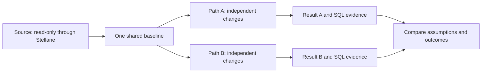

# Explore several paths from the same starting point

[中文](experiments.zh-CN.md) · [Demo datasets](../examples/README.md) · [Home](../README.md)

Stellane helps an Agent investigate a database and try more than one answer to “what if we changed this?” Each path gets its own writable database branch. Its baseline, changes and result remain traceable. The user can compare the evidence before choosing a proposal.

The important part is the **same starting data**. If A starts from this morning's source and B starts after new records arrive, the difference mixes your proposal with unrelated data changes. Save one baseline first, then start A and B from that exact environment.



The source remains outside the experimental writes. A does not see B's changes. Ending an experiment closes temporary work access while preserving its result. Applying a proposal to production is a separate decision and operation.

## When branches are useful

| Question | Why a branch helps | Evidence to compare |
| --- | --- | --- |
| “Two mapping repairs both look plausible. What would each change?” | Keep the hypotheses separate instead of repeatedly editing and undoing one database | Coverage, affected groups, preserved totals and the business evidence for each mapping |
| “Where should we route this unassigned work?” | Apply alternative routing rules to the same backlog | Total workload, team allocation and the stated capacity budget |
| “Will this schema or data transformation preserve the result?” | Test DDL or DML against an isolated state with its own derived tables | Before/after counts, aggregates, missing records and validation SQL |

A plain `SELECT` is enough when the question only needs a calculation over existing data. Branches become useful when a proposal needs persistent edits, several dependent SQL steps, or a result that should remain separately inspectable. The database provider supplies the branching mechanism; Stellane tracks the question, access and evidence.

## Two examples with known answers

The [synthetic datasets](../examples/README.md) include an initial state, a deliberate change and two single-statement proposals. The expected answers are in each `manifest.json`. No business-specific logic is embedded in the product.

### Telemetry: completeness does not prove the right mapping

After `telemetry/drift.sql`, one active event has no matching device. All **5 events / 150 units** must remain in the answer, including **1 event / 20 units** without an area.

| Path | Assumption | North | South | Unattributed |
| --- | --- | --- | --- | --- |
| Shared baseline | Keep the unresolved reference | 3 events / 90 | 1 event / 40 | 1 event / 20 |
| A | The event belongs to `device-a` | 4 events / 110 | 1 event / 40 | 0 |
| B | The event belongs to `device-c` | 3 events / 90 | 2 events / 60 | 0 |

Both proposals restore complete coverage and preserve the total. Neither proves which device actually emitted the event. This is useful precisely because it separates a technical result from the business decision: the user can see the effect of each assumption and ask for evidence about the device identity.

### Support: a complete mapping can still overload a team

After `support/drift.sql`, the backlog contains **6 open tickets / 590 estimated minutes**, including an unassigned ticket estimated at **90 minutes**. The supplied toy capacity budgets are General **300 minutes** and Specialist **480 minutes**.

| Path | General workload | Specialist workload | Unassigned | Over capacity |
| --- | --- | --- | --- | --- |
| Shared baseline | 300 | 200 | 90 | None among assigned work |
| A: route to General | 390 | 200 | 0 | General exceeds its budget by 90 |
| B: route to Specialist | 300 | 290 | 0 | Neither team exceeds its stated budget |

B fits these stated budgets. That is not proof that a specialist is eligible for the ticket, that an SLA will improve, or that real handling time will fall. Those are additional assumptions to verify. The point is to make the tradeoff visible before changing a live routing rule.

## Run the comparison in ordinary chat

First load the chosen dataset's `setup.sql` and `drift.sql` into a **dedicated synthetic Stello source**, then connect it in Stellane. Stello is the supported 0.1 branch route; the Neon route below is experimental. The SQL files deliberately use fixed demo schemas and fail if setup already exists. The [demo guide](../examples/README.md) explains the initial data and the plain PostgreSQL path.

Use one ordinary DSH project conversation. For the telemetry example:

> Use the telemetry demo source. First inspect the current active-event totals and missing relationships. Save one shared read-only baseline for two experiments. Both proposals must start from this exact baseline, not two separate captures of the live source.

Then:

> From that shared baseline, try A: set event 2's device_hint to device-a. Separately from the same baseline, try B: set it to device-c. In each independent work branch, change only that one event. Count active events and sum magnitude by area, keeping unattributed records in the total. Save both results and evidence, then end the temporary work. Compare A, B and the baseline. Do not apply either proposal to the source or infer which mapping is true.

For the support example, replace the proposals with “route open ticket 2 to General” and “route it to Specialist”. Ask for workload and over-capacity minutes using the stated budgets, along with any assumptions that remain unverified.

The Agent can save a common baseline with `stellane_checkpoint`, then create two differently named `stellane_start_experiment` tasks using that same baseline's environment ID. The normal tools handle writes, evidence capture and finishing. Tool IDs are for the Agent; the user can work with names and questions.

Open **Stellane → 任务与结果 (Activity and results)** to inspect each task, SQL, retained result and original conversation. Compare the two saved results in chat or open their evidence separately. Check that both tasks point to the same baseline ID; matching names alone are insufficient.

Current support covers multiple independently tracked experiments. There is no general parallel sub-Agent scheduler, dedicated multi-proposal comparison dashboard, or automatic merge into production. Running A and B sequentially still preserves their isolation and common starting point.

## Repeat the exact scenario without a model

### Prepare a dedicated demo source

The repository includes a deterministic runner. It calls the same Core used by the plugin, applies the published proposal SQL and checks the independent expected answers. It tests branch behavior; it does **not** demonstrate an Agent discovering the proposals on its own.

For a dedicated [local Docker Neon source](local-neon.md), or an existing test source, load the files using a database role allowed to create the demo schemas. Keep connection credentials in your usual `PGSERVICEFILE`, `PGPASSFILE` or Neon client configuration:

```sh
psql service=stellane_demo -v ON_ERROR_STOP=1 -f examples/datasets/telemetry/setup.sql
psql service=stellane_demo -v ON_ERROR_STOP=1 -f examples/datasets/telemetry/drift.sql
```

For an isolated Stello development instance, use its private database connection to load the same files. See [the Stello development setup](../DEVELOPMENT.md#stello). Do not build or run a fixture in another task's shared Stello checkout.

Use the provider configuration format in [DEVELOPMENT.md](../DEVELOPMENT.md). The database user must be able to create receipts and perform the proposal updates in the new work branches. Then, from the repository root after building:

```sh
corepack pnpm demo:branches --stello /absolute/path/provider.json --dataset telemetry
# Or a local Docker Neon source using its generated provider.json:
corepack pnpm demo:branches --neon /absolute/path/neon-source.json --dataset telemetry
```

The source must already match the dataset's **drift** state. The runner never seeds or edits the source. It checks:

1. A single baseline precedes both proposals and is reused by both task IDs.
2. A and B have distinct work branches, with access restricted to their own sessions.
3. Changing A leaves the entire B dataset unchanged.
4. Both saved results match the expected totals using the same evidence SQL. The support example also checks capacity budgets.
5. B does not change the saved A result, and the complete source dataset fingerprint is unchanged.

The command prints a private state directory containing `report.json` and `core/state.sqlite`. It uses a separate Core store, so this scripted run does not automatically appear in your existing DSH panel; the chat walkthrough above is the panel demonstration. A new run requires a new directory. To inspect an existing run without executing SQL:

```sh
corepack pnpm demo:branches status --state-dir /absolute/path/printed-run-directory
```

## Retention, cleanup and interrupted runs

Successful runs retain two result branches and the shared baseline for inspection. Stello closes and removes temporary work branches. Neon can require the work branches as ancestors of retained results; Stellane removes their computes and closes local access while reporting the retained storage. Local Docker timelines still occupy disk; cloud resources can incur charges. For chat-created experiments, use **Management → Retained branches** to remove unwanted results and then their unneeded parents. **Finish experiment** does not delete every retained result.

When finished inspecting a successful scripted run, remove only its recorded branches:

```sh
corepack pnpm demo:branches cleanup --state-dir /absolute/path/printed-run-directory
```

Cleanup verifies resource identities and works from children toward parents. It keeps the source and local SQL evidence. If cleanup is interrupted, repeat this same command to inspect the saved removal requests. Do not substitute a different directory or delete resources by name alone.

A failed or unknown run keeps its Core state and refuses automatic cleanup. Check only the original branch identities and write receipts with:

```sh
corepack pnpm demo:branches reconcile --state-dir /absolute/path/printed-run-directory
```

This observes the original operations; it does not create branches or replay SQL. `reviewed` means the outcomes are known and explicit `cleanup` is available. It does **not** mean the incomplete demo passed. The report preserves the original failure and observed resource identities; the Core records preserve the interrupted task history. If an outcome remains unknown, leave that state intact and inspect the provider before another run. A missing write receipt remains unknown, rather than being treated as permission to repeat the statement.

After a process crash, `runner.lock` may remain. Verify that its recorded process has exited before removing only that lock and running `reconcile`. This runner lock is separate from Core’s `owner.sqlite`: never delete `owner.sqlite` to bypass an active owner. Do not delete the state directory to make a failed run disappear.

Stello snapshots have a fixed-state guarantee. Neon baseline and result branches are read-only through Stellane but can be changed by external administrators; their historical observations require revalidation. Neon contract tests and real local-provider tests are separate checks. The Docker route does not need a paid cloud account; cloud validation is outside this preview. The runner reports what it actually observed rather than promising permanent immutability or zero resource cost.
