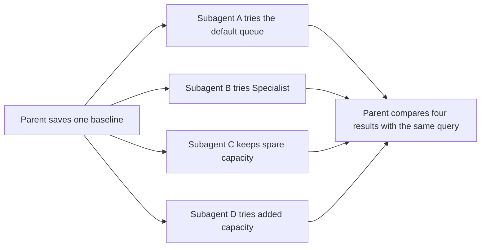

# Give each proposed change its own branch

[中文](experiments.zh-CN.md) · [Investigate a missing record](../examples/README.md) · [Home](../README.md)

When several changes look plausible, save the starting data once as a **baseline**. Give each option a work branch from that baseline, apply its edits, and compare the results with the same query. Stellane treats the source as read-only.

Say you are testing two assignments for the same ticket. Editing one database twice means you must undo the first change before testing the second. Starting twice from a live source allows new tickets to affect the comparison. Branches from one baseline give both options the same starting data and keep their edits separate.

## Proposed workflow with one task and four subagents

**This workflow is a design for the next step.** In 0.1, one ordinary chat can run several named experiments separately. Automatically launching four subagents, binding each to its work branch, and collecting their results still needs to be implemented.

Suppose one ticket has no team assigned. Each subagent would test a different assignment strategy.

| Subagent | Change on its own branch | Expected General / Specialist | What to check |
| --- | --- | --- | --- |
| A · Default queue | Send ticket 2 to General | **390 / 300**, 200 / 480 | General is over by 90 minutes |
| B · Specialist handles it | Send ticket 2 to Specialist | 300 / 300, **290 / 480** | Specialist must be eligible |
| C · Leave General 60 minutes spare | Send tickets 2 and 3 to Specialist | **240 / 300**, 350 / 480 | Specialist must be eligible for both |
| D · Add temporary General capacity | Give General 90 extra minutes and ticket 2 | **390 / 390**, 200 / 480 | The additional capacity must be available |

All four count the same six open tickets and 590 minutes of work, including 90 minutes for ticket 2. The values in the table were checked with the sample SQL.



The parent chooses the baseline, calculation and decision criteria. Each subagent works only in its assigned branch and returns the change, query result and business assumptions. The parent can show which options overload a team, reassign extra work or require added capacity. If one path fails, show its status and any evidence it produced while the other paths continue.

## Try it now with one ticket and two assignments

Our synthetic queue has **6 open tickets and 590 minutes of planned work**. Ticket 2 needs **90 minutes** and has no team assigned. Where should it go?

The baseline has General at 300 / 300 minutes and Specialist at 200 / 480. Use the A and B rows above to check where the 90 unassigned minutes go and whether General exceeds capacity.

### Prepare a dedicated demo source

Use a **dedicated Stello test source**. From the checkout, load these files in order using a role that can create the demo schema. Replace the sample psql service `stellane_demo` with your configured test connection. The second file creates the unassigned ticket.

```sh
psql service=stellane_demo -v ON_ERROR_STOP=1 -f examples/datasets/support/setup.sql
psql service=stellane_demo -v ON_ERROR_STOP=1 -f examples/datasets/support/drift.sql
```

Open **Stellane → Data sources → Add data source → Stello**. Enter the client configuration file, source database and branch, and choose your DSH project. If you need a test instance, follow the [Stello development setup](../DEVELOPMENT.md#stello).

### Run the comparison in ordinary DSH chat

> Use the Stello source with `stellane_demo_support`. Save one common baseline. From it, start two experiments called “A to General” and “B to Specialist”. In each branch, change only ticket 2's assignment. Use the same query to compare estimated minutes for open tickets with each team's capacity. Include unassigned work. Save each result and its SQL evidence, then finish the temporary work.

Open the two experiments in **Stellane → Activity and results**. Check their common baseline, individual edits and evidence SQL. When done, remove saved results under **Management → Retained branches**, then follow the panel's guidance to remove the baseline.

To continue the missing-record walkthrough, use the [telemetry data](../examples/datasets/telemetry/README.md). Both candidate repairs restore coverage, but one puts the missing 20 in North and the other in South. You still need evidence about which device produced the event.

[Developer commands for reproducing and recovering experiments](../DEVELOPMENT.md#真实分支对照) · [0.1 verification](release-status.md)
