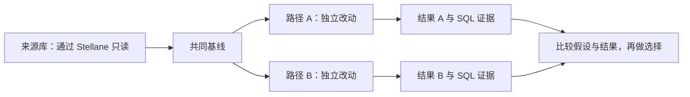

# 从同一起点，探索多条试验路径

[English](experiments.md) · [演示数据与步骤](../examples/README.zh-CN.md) · [项目首页](../README.zh-CN.md)

Stellane 让 Agent 调查数据库，也让它把不同假设分别试出来。每条路径有独立的可写数据库分支，保留自己的改动、结果和证据。用户看清影响后再决定采用哪种方案。

**关键是同一个起点。** 如果 A 用上午的数据，B 用下午新增记录后的数据，结果差异就混进了其他变化。先保存一次基线，再让 A、B 都从这个确切的环境出发。



试验写入不会进入来源库，A 的改动不会串进 B。结束实验关闭临时工作访问，保留结果。是否采纳到生产，由用户的业务流程决定。

## 什么时候有价值

| 问题 | 分支帮了什么 | 要比较的证据 |
| --- | --- | --- |
| 两种映射修复都看起来合理，各自会改变什么？ | 保留两个独立假设，避免在同一库反复修改和回滚 | 归因覆盖、各组变化、总量，以及真实业务依据 |
| 这批未分配工作应交给哪个团队？ | 对同一批任务分别应用不同路由策略 | 工作量、分配结果和明确的容量约束 |
| 一次结构调整或数据转换，会不会改变原来的结果？ | 在自己的数据状态上试 DDL / DML 和后续多步计算 | 改动前后的行数、指标、缺失记录及核验 SQL |

只需对现有数据做一次计算时，普通只读 SQL 就够了。需要实际修改、连续多步 SQL，或希望把不同结果分别留下来查证时，分支才发挥作用。数据库提供分支机制，Stellane 记录问题、访问范围和证据。

## 两个能算清楚的例子

[演示数据](../examples/README.zh-CN.md)提供初始数据、一次故意制造的变化，以及两个单条 SQL 方案。每套数据的 `manifest.json` 给出独立预期。产品实现不包含针对这些业务的特殊处理。

### 事件归属：覆盖完整，不代表映射就正确

执行 `telemetry/drift.sql` 后，一条 active 事件找不到设备。答案仍须包含全部 **5 条事件 / 150 单位**，其中 **1 条 / 20 单位** 暂时无法归属区域。

| 路径 | 假设 | North | South | 未归因 |
| --- | --- | --- | --- | --- |
| 共同基线 | 保留待查的设备引用 | 3 条 / 90 | 1 条 / 40 | 1 条 / 20 |
| A | 这条事件属于 `device-a` | 4 条 / 110 | 1 条 / 40 | 0 |
| B | 这条事件属于 `device-c` | 3 条 / 90 | 2 条 / 60 | 0 |

两种方案都补齐覆盖，而且总量不变。它们不能证明事件究竟来自哪台设备。分支的价值是把两种假设的影响摆出来，下一步再寻找真实设备归属的证据，而不是让 Agent 只凭“全部匹配”就选一条。

### 工单分配：补齐关联后，也可能超出容量

执行 `support/drift.sql` 后，积压任务为 **6 张 open 工单 / 590 分钟预计工作量**，其中一张 **90 分钟**的工单未分配。演示给定 General **300 分钟**、Specialist **480 分钟**的容量。

| 路径 | General 工作量 | Specialist 工作量 | 未分配 | 超量 |
| --- | --- | --- | --- | --- |
| 共同基线 | 300 | 200 | 90 | 已分配部分未超量 |
| A：交给 General | 390 | 200 | 0 | General 超出 90 |
| B：交给 Specialist | 300 | 290 | 0 | 两队均未超给定容量 |

B 满足这组明确约束，但还不能证明 Specialist 有处理资格、SLA 会改善或实际耗时会减少。那些是后续要核对的假设。试验先把策略取舍显示出来，避免直接改线上路由后才发现问题。

## 在普通对话里操作

先在**专用 Stello 测试来源**导入所选数据集的 `setup.sql` 和 `drift.sql`，并在 Stellane 接入。0.1 验收 Stello 分支，后文的 Neon 路径仍是实验性的。SQL 使用专用演示 schema，重复 setup 会失败。[演示指南](../examples/README.zh-CN.md)介绍初始数据与普通 PostgreSQL 上手路径。

在同一个普通 DSH 项目对话里，以事件数据为例先说：

> 使用事件演示数据源，先查看 active 事件的总数、合计和缺失关系。为两个方案只保存一次共同的只读基线。两种方案必须从这个确切基线出发，不能各自重新读取实时库作为起点。

然后说：

> 从刚才的共同基线分别试两条路径。A 把事件 2 的 device_hint 改为 device-a；B 改为 device-c。每条路径只修改自己分支里的这条事件。按区域统计 active 事件数和 magnitude 合计，未归因记录也计入总量。分别保留结果和证据，结束临时工作，再比较 A、B 与基线。不要把改动应用到来源库，也不要擅自断定哪种设备映射是真的。

工单例子可以改成“把 open 工单 2 交给 General”和“交给 Specialist”，要求同时核对总工作量和给定容量，列出尚未验证的业务前提。

Agent 可先用 `stellane_checkpoint` 保存共同基线，再以相同基线环境 ID 创建两个不同名称的 `stellane_start_experiment`。普通工具负责写入、证据交付与结束实验。工具 ID 留给 Agent 使用，用户按名称和问题操作即可。

在 **Stellane → 任务与结果** 分别查看两项实验、SQL、保留结果和原对话。可以在聊天中比较结论，也可以分别打开两份证据。核对两个任务引用的是同一个基线 ID，仅名称相同不足以证明起点相同。

当前支持多项独立记录的实验，尚未提供通用的并行子 Agent 调度器、专门的多方案对比大屏或自动合并到生产。顺序执行 A、B，同样能保证它们各自独立并从同一起点开始。

## 不依赖模型，复现同一套对照

### 准备专用演示来源

仓库提供确定性演示脚本，直接调用插件使用的 Core，执行公开的方案 SQL 并核对独立预期。它验证分支行为，**不能作为 Agent 自主发现方案的证明**。

在[本地 Docker Neon 专用来源](local-neon.zh-CN.md)或已有测试来源里，可用有建表权限的数据库角色导入文件；连接凭据沿用自己的 `PGSERVICEFILE`、`PGPASSFILE` 或 Neon 客户端配置：

```sh
psql service=stellane_demo -v ON_ERROR_STOP=1 -f examples/datasets/telemetry/setup.sql
psql service=stellane_demo -v ON_ERROR_STOP=1 -f examples/datasets/telemetry/drift.sql
```

独立 Stello 开发实例通过自己的数据库连接导入同样文件，部署方法见[开发说明](../DEVELOPMENT.md#stello)。不要在其他任务共用的 Stello 工作目录原地构建或运行测试。

按 [DEVELOPMENT.md](../DEVELOPMENT.md) 准备来源配置。数据库角色需要能在新工作分支中创建回执、执行方案更新。项目完成构建后执行：

```sh
corepack pnpm demo:branches --stello /absolute/path/provider.json --dataset telemetry
# 或使用本地 Docker Neon 输出的 provider.json：
corepack pnpm demo:branches --neon /absolute/path/neon-source.json --dataset telemetry
```

来源必须已处于演示的 **drift 状态**。脚本不会为来源建表或修改数据，验收内容包括：

1. 两项任务引用同一个预先保存的基线。
2. 两条工作分支互不相同，各自会话不能读写另一条私有分支。
3. 修改 A 后，尚未修改的 B 仍保持完整基线数据。
4. 两份保留结果用相同 SQL 计算，并与独立预期一致；工单场景还核对容量。
5. B 不改变已保存的 A 结果，来源数据集的完整指纹也保持不变。

命令会打印私有状态目录，其中保存 `report.json` 和 `core/state.sqlite`。脚本使用独立 Core 状态，因此不会自动出现在现有 DSH 面板；需要看面板时使用上面的普通对话演练。每次新运行使用新目录。只查看原记录而不执行 SQL：

```sh
corepack pnpm demo:branches status --state-dir /absolute/path/printed-run-directory
```

## 保留、清理与中断

成功后保留两份结果和共同基线，供继续核对。Stello 结束并删除临时工作分支。Neon 结果可能依赖工作分支祖先，Stellane 会移除这些工作分支的 compute、关闭本地访问，并说明仍保留的存储。本地 Docker timeline 仍占磁盘，云资源可能产生费用。对聊天中创建的试验，用「管理与清理 → 保留的分支」先回收不需要的结果，再回收没有依赖的父分支。「结束实验」不等于删除所有保留结果。

查看完成功脚本的结果后，只清理这次演示所记录的分支：

```sh
corepack pnpm demo:branches cleanup --state-dir /absolute/path/printed-run-directory
```

清理按真实身份核对，从结果向父分支执行，保留来源和本地 SQL 证据。清理中断后重复同一条命令核对已保存的删除请求，不要改成另一个目录，也不要只按资源名称删除。

失败或结果未知时，脚本保留 Core 状态，拒绝自动清理。使用以下命令，仅核对原分支身份和原写入回执：

```sh
corepack pnpm demo:branches reconcile --state-dir /absolute/path/printed-run-directory
```

它只观察原操作，不创建分支、不重放 SQL。`reviewed` 表示结果已核对、可以显式执行 `cleanup`，**不代表未完成的演示通过了验收**。报告保留最初失败和观察到的资源身份，Core 记录保留中断任务的历史。如果还有未知结果，保留现场，先检查提供方。找不到写入回执时仍保持未知，不会据此重复执行 SQL。

进程崩溃后可能留下 `runner.lock`。先确认其中记录的进程已经退出，再仅删除该锁文件并执行 `reconcile`。这与 Core 的 `owner.sqlite` 是两种锁；永远不要删 `owner.sqlite` 绕过占用。不要通过删除整个状态目录掩盖失败。

Stello 提供固定数据切面。Neon 的基线和结果通过 Stellane 只读，外部管理员仍可能修改；历史观察需要复核。Neon 的 API 契约测试与真实本地提供方测试分别记录；Docker 路径不需要付费云账号，云端验收不在 0.1 范围内。脚本只报告实际观测结果，不承诺永久不可变或零资源开销。
