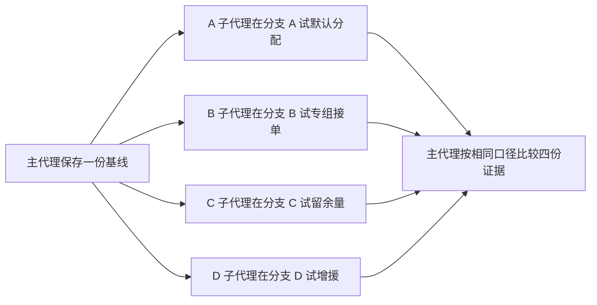

# 给每种改法一条试验分支

[English](experiments.md) · [从报表追到漏数原因](../examples/README.zh-CN.md) · [首页](../README.zh-CN.md)

遇到几种可能的改法时，先保存一份初始数据，叫作**基线**。每个方案从这份数据开自己的工作分支。在各自的分支上实际改数据或表结构，再用同一条查询比较结果。来源库在 Stellane 里保持只读。

比如同一张工单试交给两个团队。只在一个库里先改 A 再改 B，容易漏掉还原步骤。分别从实时库开始，新增的工单又会影响比较。从同一基线开分支，两边的数据起点一样，方案的改动也互不影响。

## 目标用法：发起一次任务，四个子代理各试一条路

**这是下一步的工作流设计。** 0.1 可以在同一普通对话中分别运行多个命名实验。自动启动四个子代理、给每个子代理绑定一条工作分支并汇总结果，还需要实现。

假设有一张待分配的工单。四个子代理分别研究一种分配策略：

| 子代理研究什么 | 各自在分支做什么 | 预期 General / Specialist | 主代理需要核对 |
| --- | --- | --- | --- |
| A · 按默认队列接单 | 把工单 2 给 General | **390 / 300**、200 / 480 | General 超出 90 分钟 |
| B · 由 Specialist 接单 | 把工单 2 给 Specialist | 300 / 300、**290 / 480** | Specialist 是否有处理资格 |
| C · 给 General 留 60 分钟余量 | 把工单 2 和 3 都交给 Specialist | **240 / 300**、350 / 480 | 两张工单都需要 Specialist 的资格 |
| D · 临时给 General 增援 | 给 General 增加 90 分钟容量，再把工单 2 给它 | **390 / 390**、200 / 480 | 是否能调来这 90 分钟的容量 |

四个方案都统计同样的 6 张待处理工单、590 分钟，其中工单 2 占 90 分钟。表里的工作量和容量都以分钟计，四组数值已用样例 SQL 核对。



主代理负责确定基线、统计口径和选择标准。每个子代理只在自己的工作分支修改数据，并交付改动、查询结果和业务前提。主代理拿到各条路径的证据后，能看清哪些方案超容量、哪些需要改派、哪些依赖额外资源。某条路径失败时，报告应单列该路径的状态和已取得的证据，其他路径可继续。

## 现在就能试：一张工单，两种分法

专用演示库里有 **6 张待处理工单，共 590 分钟工作量**。其中工单 2 预计要 **90 分钟**，目前没有分配。把它分给谁？

共同基线里，General 已排 300 / 300 分钟，Specialist 已排 200 / 480 分钟。照上表验证 A 和 B，重点看未分配的 90 分钟去了哪里，以及 General 是否超容量。

### 准备演示库

用一个**专用 Stello 测试来源**。在源码目录，用有建表权限的连接依次导入下面两个 SQL 文件。`stellane_demo` 是示例 psql 服务名，换成你已经配置的测试连接。初始化文件会创建专用 schema，第二个文件才会制造未分配工单。

```sh
psql service=stellane_demo -v ON_ERROR_STOP=1 -f examples/datasets/support/setup.sql
psql service=stellane_demo -v ON_ERROR_STOP=1 -f examples/datasets/support/drift.sql
```

打开 **Stellane → 数据源 → 添加数据源 → Stello**，填客户端配置文件、来源数据库和分支，选择要使用的 DSH 项目。没有测试实例时，先看 [Stello 开发环境说明](../DEVELOPMENT.md#stello)。

### 在普通 DSH 对话里比较

> 使用 Stello 数据源的 `stellane_demo_support`。保存一次共同基线，从它分别创建「A 给 General」和「B 给 Specialist」两个实验。每个实验只在自己的分支上改工单 2 的分配。用相同的查询比较各组待处理工单的预计分钟数和容量，列出未分配工作量。保存各自结果与 SQL 证据，然后结束临时工作。

在 **Stellane → 任务与结果** 打开两项实验，核对共同基线、各自的改动和证据 SQL。用完后从 **管理与清理 → 保留的分支** 先回收结果，再按面板提示回收基线。

想延续漏数演示时，可以用 [telemetry 数据](../examples/datasets/telemetry/README.md)。A、B 都能补上缺失关联，但会把那 20 分别计入 North 或 South。两份结果正好说明还需要核实设备身份。

[开发者复现实验和恢复命令](../DEVELOPMENT.md#真实分支对照) · [0.1 实测范围](release-status.zh-CN.md)
