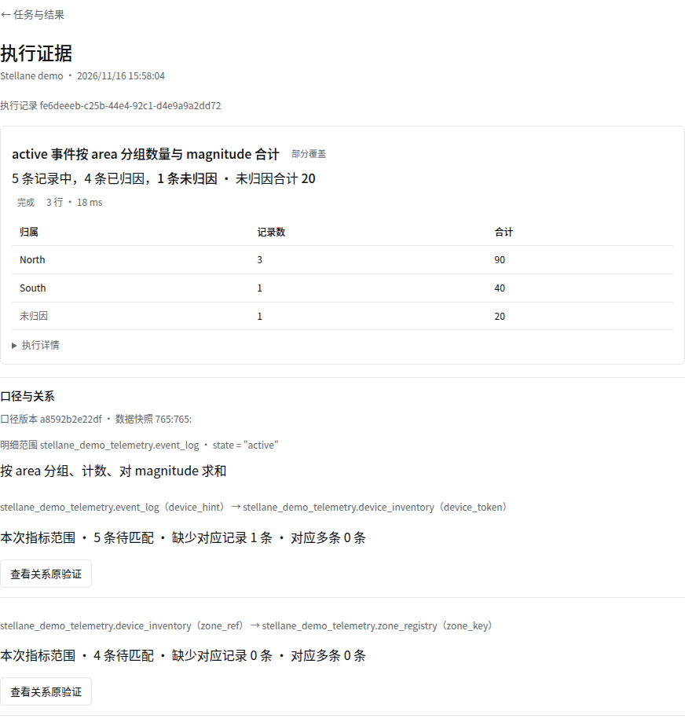
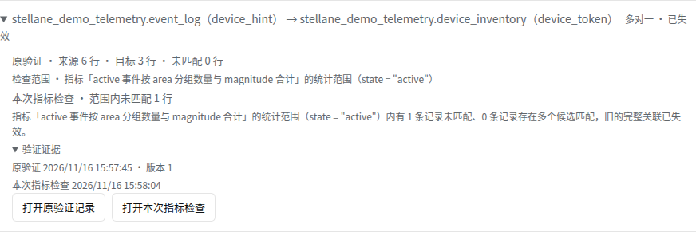

# Find the missing amount in a report

[中文](README.zh-CN.md) · [Install Stellane](../README.md#install-and-ask-a-question) · [Branch experiments](../docs/experiments.md)

**The source adds up to 150. Why does the report show 130?** Start with a complete report, break one device match, then trace which row disappeared. This walkthrough uses PostgreSQL and synthetic data.

## Connect the demo database

Install Stellane, start Docker and run these commands on the machine hosting DSH:

```sh
export STELLANE_DEMO_HOME="$HOME/Temp/stellane-demo"
dsh plugin --profile web exec stellane-demo start
dsh plugin --profile web exec stellane-demo url
```

1. Open **Stellane → Data sources → Add data source**. Select **PostgreSQL** and paste the URL from the second command.
2. Use the **Project** path printed by `start`. Name the connection `Stellane demo` if you like, then click **Connect and start**.
3. Click **Ask in project chat**. For the later prompts, start a fresh chat in the same project.

## 1. Follow the report to its tables and check the joins

> In schema `stellane_demo_telemetry`, show which tables feed the `active_event_totals` view. Count active events by area from the detail table. Check that the joins cover all active events and save the relationships you verify.

Open **Data catalog → Relationships and lineage**:

| Look at | What it tells you |
| --- | --- |
| Lineage for `active_event_totals` | PostgreSQL records which tables and fields the view references. This view uses `event_log`, `device_inventory` and `zone_registry`. |
| Verified relationships | Checks on actual rows tell you whether each event matches a device and each device matches an area. This dataset has no declared foreign keys, so the evidence comes from the data. |

Expect **North 4, South 1**, for **5 active events**. In a new chat in that project, ask:

> Reuse the relationships we found in `stellane_demo_telemetry`. Check that they still apply, then sum magnitude by area for active events.

Expect **North 110, South 40, total 150**. The chat can start with the two saved relationships, then check them against the current data.

## 2. Break one match and find the missing row

Keep the connection and saved observations. In the same terminal, run:

```sh
dsh plugin --profile web exec stellane-demo drift telemetry
```

In another new chat, ask:

> In `stellane_demo_telemetry`, compare the `active_event_totals` report with counts and magnitude sums for all active source events. Use Stellane’s metric check to include unmatched records. Show where the numbers diverge and provide the query evidence.

| Area | Events | Magnitude |
| --- | ---: | ---: |
| North | 3 | 90 |
| South | 1 | 40 |
| Unattributed | 1 | 20 |
| **Total** | **5** | **150** |

Event 2 now points to a missing device. The existing report's inner join drops it and returns **4 events and 130**. The coverage check shows that event separately and keeps it in the total.

- Open **View metric evidence** below the answer. Look for the active filter, SQL and the join that failed to match one event.
- Open **Data catalog → Relationships and lineage → History and invalidated observations**. Expand the old relationship to compare its first check with the failed recheck.

<details>
<summary>See screenshots from the demo</summary>





</details>

The same checks can help when orders need a channel, inventory needs a warehouse, or tickets need a team. Follow the report dependencies, then check which rows can still be matched today.

## 3. Use Stello to try different changes

Assigning the event to North or South changes the area totals. You can test both changes on branches from one saved starting point. The ordinary PostgreSQL demo supports read-only investigation. Use a Stello source for branch experiments. [See the walkthrough and the four-subagent design](../docs/experiments.md).

## Finish the demo

```sh
dsh plugin --profile web exec stellane-demo verify telemetry
dsh plugin --profile web exec stellane-demo stop
```

`verify` checks the current dataset against the expected values. `stop` keeps the data for the next `start`. Use `reset` to restore the demo tables, then recheck saved relationships. Use the same `STELLANE_DEMO_HOME` setting in a new terminal.

For a dedicated database of your own, load the [telemetry SQL](datasets/telemetry/README.md) and connect with a read-only role. [See the verification results](../docs/release-status.md).
