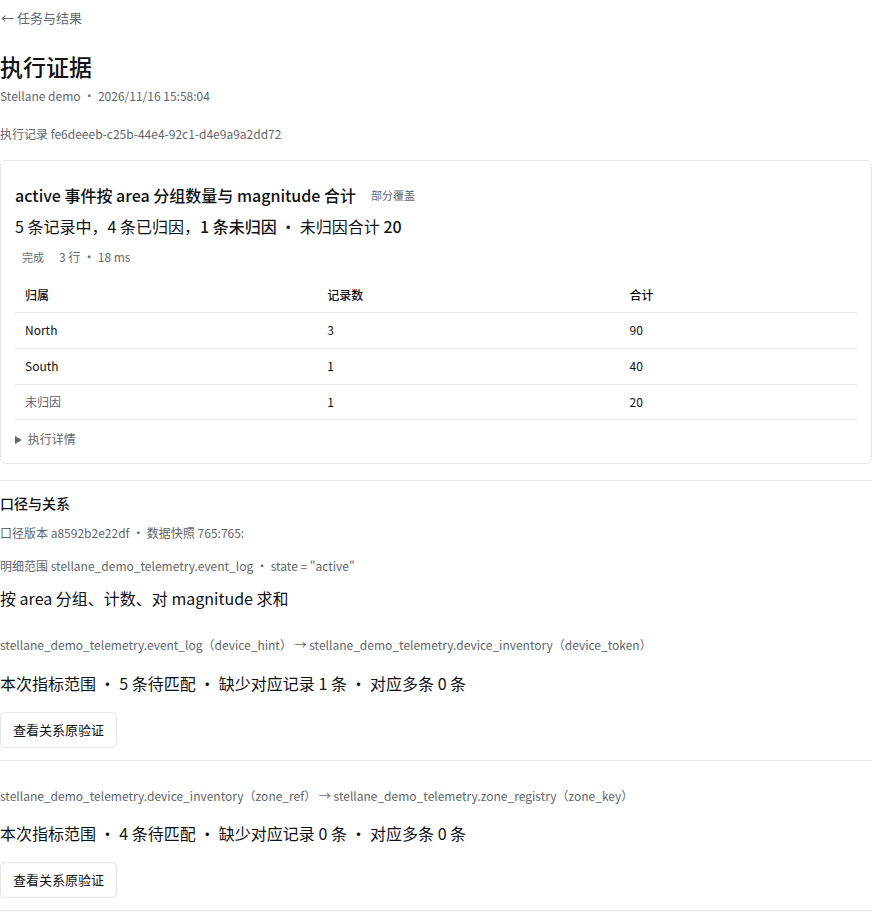
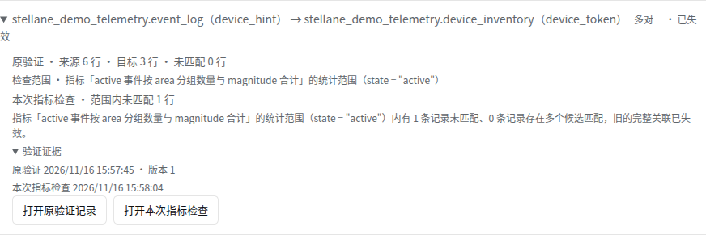

# 用模拟数据体验 Stellane

这套演示回答三个问题：Agent 能否查明陌生数据库的关系，新对话能否复用发现并识别旧知识失效，以及能否从同一个起点比较不同改法。

全部数据均为合成数据，使用普通 PostgreSQL 表、注释和视图。产品代码没有为这些演示表写特殊逻辑。

[English](README.md) · [安装方法](../README.zh-CN.md#安装) · [多条试验路径](../docs/experiments.zh-CN.md)

## 先选一个场景

| 演示 | 能看到什么价值 | 需要什么数据库 |
| --- | --- | --- |
| 1. 查明关系并记住 | 找到隐性关联，新对话可从已验证发现继续分析 | PostgreSQL 或 Neon URL |
| 2. 数据变了，旧关系失效 | 重新核对、保留未归因记录、追查原结论为何不再成立 | PostgreSQL 或 Neon URL |
| 3. 两条修复路径 | 同一基线验证两种映射，理解为什么“全部匹配”还不足以证明正确 | Neon 分支或 Stello |
| 4. 两种工作量分配方案 | 分别模拟调度决策，对照明确的容量预算比较结果 | Neon 分支或 Stello |

先跑前两项，之后进入[多路径试验指南](../docs/experiments.zh-CN.md)。分支让不同假设有各自的数据状态和证据。

## 准备本地演示库

先按主 README 安装预览包，在运行 Harness Host 的同一台机器执行，需要 Docker 可用。前两项分析与记忆演示不需要源码仓库；源码用户可以把全文命令中的 `dsh plugin --profile web exec stellane-demo` 换成 `corepack pnpm demo`：

```sh
dsh plugin --profile web exec stellane-demo start
dsh plugin --profile web exec stellane-demo url
```

脚本会创建专用 PostgreSQL 17 容器、只读账号、两套数据和项目目录，端口随机且仅绑定 `127.0.0.1`。它与日常开发数据库分开。

1. 复制 `demo url` 打印的连接地址。
2. 在 DSH 打开 **Stellane → 数据源 → 添加数据源**，选择 PostgreSQL，粘贴 URL。
3. 项目目录选择 `demo start` 输出的绝对路径，安装包默认是 **`~/.local/share/stellane-demo/project`**。连接名称可填写 `Stellane demo`。
4. 点击 **连接并开始使用**。
5. 点击连接卡片的 **在项目中提问**，直接进入正确项目的普通对话。之后需要新对话时，将鼠标移到 Harness 工作区侧栏的这个项目名，点击新建会话按钮。后续日常操作可以一直在聊天里完成。

再次执行 `start` 会保留已有数据。连接文件和密码由脚本生成，安装包保存在 `~/.local/share/stellane-demo/`，源码方式保存在 Git 忽略的 `.stellane-dev/demo/`；绝对路径 `STELLANE_DEMO_HOME` 可以覆盖默认位置。

```sh
dsh plugin --profile web exec stellane-demo status
dsh plugin --profile web exec stellane-demo verify
dsh plugin --profile web exec stellane-demo stop
```

`stop` 停止容器并保留数据，`start` 可以恢复。要从头演示，可重建两套模拟数据：

```sh
dsh plugin --profile web exec stellane-demo reset
```

`reset` 仅重建演示 schema，表的对象身份会变化，Stellane 里之前保存的观察需要重新验证。

## 1. 查清关系，再换个对话问新指标

先用 **telemetry** 数据。事件、设备和区域分为三张表，没有外键约束，注释说明各自含义。有一条事件不是 active，不能算进本次指标。

在第一个普通对话里说：

> 使用 Stellane demo 数据库的 `stellane_demo_telemetry`，按区域统计 active 事件数。请调查表之间如何关联，检查是否覆盖全部 active 事件，并记住有验证依据的关系。

预期结果：

| 区域 | active 事件数 |
| --- | ---: |
| North | 4 |
| South | 1 |
| **合计** | **5** |

在 **数据目录 → 关系与血缘** 查看事件到设备、设备到区域这两段关联及其验证证据。已有视图 `active_event_totals` 也有从数据库目录读取的上游血缘。前者来自数据检查，后者来自数据库声明，来源应能区分。

在同一项目**新开一个普通对话**：

> 用上次对 `stellane_demo_telemetry` 的发现，按区域统计 active 事件的 magnitude 合计，先核对保存的关系现在是否还适用。

预期为 **North 110、South 40、总计 150**。Agent 应能找到已保存的关系，并在实时数据上核对后使用。具体探索 SQL 和工具次数可能变化，关注答案、证据和复用是否正确。

**适用场景：** 数据库文档不全，同一个团队或 Agent 经常围绕相同数据追问。后续分析可以从已有发现继续，同时检查当前数据是否仍支持它。

## 2. 改坏一条关联，看旧记忆如何失效

保留刚才的连接和记忆，在终端修改一条模拟事件的设备引用：

```sh
dsh plugin --profile web exec stellane-demo drift telemetry
```

再新开对话：

> 按区域统计 `stellane_demo_telemetry` 的 active 事件数和 magnitude 合计，不能归因的记录也要列出来。

预期结果：

| 区域 | 事件数 | magnitude 合计 |
| --- | ---: | ---: |
| North | 3 | 90 |
| South | 1 | 40 |
| 未归因 | 1 | 20 |
| **合计** | **5** | **150** |

总量必须仍为 150。原有内连接视图此时只返回 130，因为它漏掉了那条无法匹配设备的事件。这展示了“SQL 能执行成功”与“回答覆盖了问题要求的数据”之间的差别。

点击回答下方的 **查看指标证据**，检查统计范围、筛选条件、未归因数量和 SQL。在 **数据目录 → 关系与血缘** 中展开 **历史与失效记录**，打开旧关系，查看原验证、本次检查和失效原因。如果新证据只检查某个指标范围，界面应明确这个范围，不能把数量误当作整表复核。

下面是这套模拟数据在真实 DSH 对话后的面板截图。指标证据保留了未归因记录；旧关系同时保留原验证和使其失效的本次检查。





独立核对公开的预期结果：

```sh
dsh plugin --profile web exec stellane-demo verify telemetry
```

**适用场景：** 实时数据、迟到的映射信息、不完整的维表，以及会悄悄丢掉记录的关联报表。复核在使用时发生，Stellane 当前不会持续监听所有外部写入。

## 3. 从同一基线走两条修复路径

那条未归因事件的 magnitude 为 20。现在要分别验证两个假设：

- **方案 A：** 事件来自 North 的 `device-a`。
- **方案 B：** 事件来自 South 的 `device-c`。

两者都能恢复完整匹配，也都保留 5 条事件、150 总量，但区域分布不同。仅凭关联检查通过，不能判定哪种修复符合事实。

在 Neon 分支或 Stello 上按[多路径试验指南](../docs/experiments.zh-CN.md)操作：只保存一次共同基线，分别创建 A/B 工作分支、保存结果、比较差别，再结合业务证据决定采用哪一条路径。本地普通 PG 演示库可验证查询与记忆，安装插件并不会给它增加数据库分支能力。

## 4. 换个业务，比较两种工作量分配方案

**support** 数据集包含工单、预计工作量、两个队列及容量预算，使用另一种关系结构。先看[数据说明](datasets/support/README.md)，再引入工作量变化：

```sh
dsh plugin --profile web exec stellane-demo drift support
dsh plugin --profile web exec stellane-demo verify support
```

变化后共有 **6 张未关闭工单、590 分钟预计工作量**，其中 **1 张工单、90 分钟尚未分配**。在分支提供方上比较：

| 方案 | General 工作量 / 容量 | Specialist 工作量 / 容量 | 数据能支持的结论 |
| --- | ---: | ---: | --- |
| A：将未分配工单交给 General | 390 / 300 | 200 / 480 | General 超过预算 90 分钟 |
| B：交给 Specialist | 300 / 300 | 290 / 480 | 两边都在给定预算内 |

这个结果不能证明 Specialist 一定具备处理资格，也不能证明客户等待时间会缩短。它展示的是一种通用方法：明确假设和判定标准，分别试算，保留证据，再比较。

## 数据文件和核验方式

每个[数据集目录](datasets/)包含：

| 文件 | 用途 |
| --- | --- |
| `setup.sql` | 建表、造数据和说明含义；同名 schema 已存在时会失败 |
| `drift.sql` | 引入文档描述的数据变化 |
| `variant-a.sql`、`variant-b.sql` | 两条试验路径各自的一项明确改动 |
| `manifest.json` | 独立核对 SQL、写明的预期结果、统计范围与解释 |
| `README.md` | 表结构、各阶段预期，以及不能从样例推导的结论 |

Manifest 用于复现和独立验收。普通对话里的探索由 Agent 完成，不需要把预期 SQL 或关系 ID 预先塞给它。

没有 Docker 时，也可以在专用 PostgreSQL 测试库中用 `psql` 执行选定的 `setup.sql`，给分析账号该 schema 的 `USAGE` 和表的 `SELECT` 权限，再接入 URL。分支来源的具体准备方法见[试验指南](../docs/experiments.zh-CN.md)。脚本的 `drift/reset` 只操作它管理的本地容器；其他测试库显式执行公开 SQL 即可。

## 常见问题

- **首次 Docker 启动失败：** 处理提示的 Docker 问题后，再运行 `demo start`。未完成的初始化会沿用原凭据与数据卷。请继续使用同一演示状态目录（设置过 `STELLANE_DEMO_HOME` 时也保持一致），不要接管另一套演示资源。
- **对话找不到数据源：** 核对连接与聊天是否使用相同的绝对项目目录。
- **数字与预期不同：** 用 `demo status` 和 `demo verify` 看当前阶段；上一次演示可能已改过数据。重新做首次探索时执行 `reset`。
- **没看到保存的关系：** 明确让 Agent 调查并记住经过验证的关联，再检查目录里的证据。查询结果本身不等于已保存记忆。
- **SQL 失败：** 在「任务与结果」检查错误和数据范围。失败的查询不能当作关系成立的证据。
- **不能开始分支试验：** 普通 PG 和仅使用 URL 的 Neon 支持分析与记忆，隔离写入需另接[本地 Docker Neon](../docs/local-neon.zh-CN.md) 或 Stello。

执行 `pnpm dev:db` 后可运行 `pnpm test:demo`，用真实 PG 检查公开数据、预期数字和 Core 行为。`pnpm demo:branches` 使用真实提供方分支。确定性脚本验收与实际 Agent 对话分别记录，具体见[开发与验收](../DEVELOPMENT.md)。

实际对话、脚本检查与恢复限制分别记录在[本次演示验收记录](../docs/demo-validation.md)中。安装包在 rc.3 的完整上手过程另见[独立代理首次使用验收](../docs/first-use-validation.zh-CN.md)。
