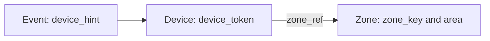

# Telemetry fixture and expected results

Use these synthetic data and expected results with the [DSH relationship walkthrough](../../README.md) or the [branch verification steps](../../../DEVELOPMENT.md#真实分支对照).

The dataset has six events, three devices and two zones. Five events are active. There are no declared foreign keys. Table and column comments provide the meaning of the records; the Agent still needs to inspect and verify the relationships.

`magnitude` is a generic measurement, with no assumed currency or physical unit. The metric counts active event rows and sums their magnitude by area.

| Stage | North | South | Unattributed | Total |
| --- | --- | --- | --- | --- |
| Initial data | 4 events / 110 units | 1 / 40 | 0 / 0 | 5 / 150 |
| After drift | 3 / 90 | 1 / 40 | 1 / 20 | 5 / 150 |
| Alternative A | 4 / 110 | 1 / 40 | 0 / 0 | 5 / 150 |
| Alternative B | 3 / 90 | 2 / 60 | 0 / 0 | 5 / 150 |

`drift.sql` changes event 2's device token to `missing-device`. The pre-existing inner-join view then reports only 130 units. A complete answer keeps the missing 20 units visible and explains why the old relationship no longer covers every event.

From the same baseline after drift, alternative A sets event 2 to `device-a`, while B sets it to `device-c`. Both restore coverage, but each attributes the 20 units to a different area. These updates make branch isolation easy to check. To choose a real repair, confirm the device in the source records.

- `setup.sql` creates the schema and data, and fails if the schema already exists.
- `drift.sql` simulates the external change. It is safe to repeat within this demo.
- `variant-a.sql` and `variant-b.sql` each contain one proposed update for a separate branch.
- `manifest.json` provides independent expected results, a verification query and a whole-dataset fingerprint query. The fingerprint detects changes; it is not a database snapshot guarantee.

Use the expected results to check the Agent's queries independently.
